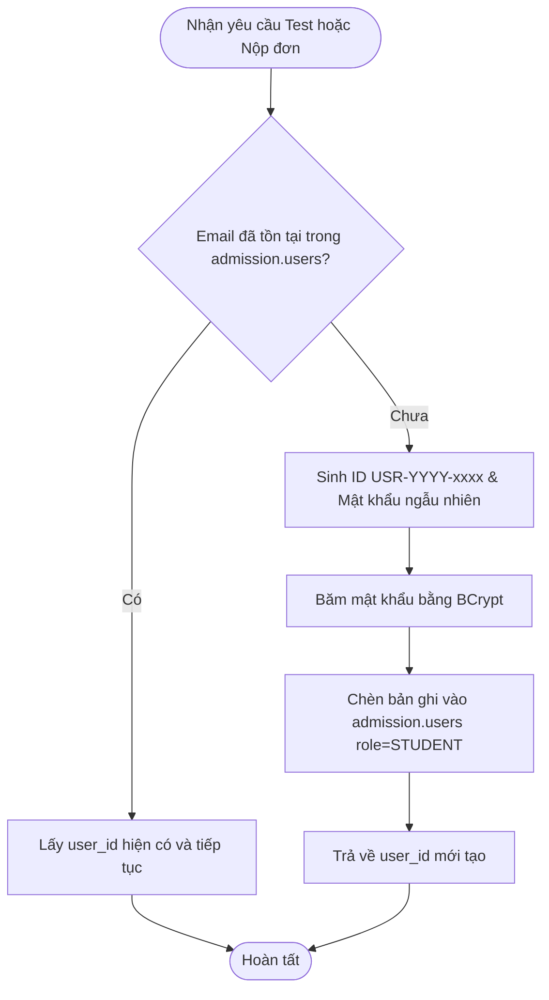

# TASK-ADM-10: Tự động Sinh Tài khoản Học viên khi Test hoặc Đăng ký Online

- **Mã nhiệm vụ**: `TASK-ADM-10`
- **Phân kỳ**: `Phase 1: Quản trị Định danh & Phiên (IAM)`
- **Độ ưu tiên**: `P1`
- **Yêu cầu chức năng liên quan**: `FR-IAM-01`
- **Quy tắc bất biến bảo vệ**: `INV-ADM-02` (Dữ liệu người dùng độc nhất), `INV-SEC-01`

---

## 1. Mục tiêu Nghiệp vụ & Kỹ thuật
Khi một học viên mới thực hiện bài kiểm tra trình độ đầu vào (Placement Test) hoặc nộp đơn đăng ký lớp học trực tuyến qua Cổng Tuyển sinh:
1. Hệ thống tự động kiểm tra xem `email` đã tồn tại trong bảng `admission.users` chưa.
2. Nếu chưa tồn tại:
   - Tự động sinh mã `user_id` định dạng `USR-yyyy-XXXX` (hoặc UUID).
   - Tạo mới bản ghi người dùng với vai trò `role = 'STUDENT'`.
   - Sinh mật khẩu ngẫu nhiên an toàn hoặc mật khẩu mặc định (được mã hóa BCrypt), đánh dấu cờ yêu cầu đổi mật khẩu.
   - Kích hoạt trạng thái tài khoản `is_active = true`.
3. Nếu email đã tồn tại:
   - Tái sử dụng `user_id` hiện có, liên kết bài test hoặc đơn đăng ký với tài khoản đó.

---

## 2. Phạm vi File Tác động

### File tạo mới hoặc chỉnh sửa:
- `services/admission/backend/src/main/java/com/englishcenter/admission/service/UserService.java`
- `services/admission/backend/src/main/java/com/englishcenter/admission/service/impl/UserServiceImpl.java`
- `services/admission/backend/src/main/java/com/englishcenter/admission/repository/UserRepository.java`
- `services/admission/backend/src/main/java/com/englishcenter/admission/dto/user/CreateStudentAccountRequest.java`

---

## 3. Đặc tả Nghiệp vụ & Logic Xử lý



### Phương thức Service:
```java
/**
 * Tự động tìm kiếm hoặc khởi tạo tài khoản học viên từ thông tin nộp đơn/khảo thí
 * @param email Địa chỉ email của học viên
 * @param fullName Họ và tên đầy đủ
 * @param phone Số điện thoại liên hệ
 * @return Đối tượng User đại diện cho học viên
 */
User getOrCreateStudentUser(String email, String fullName, String phone);
```

---

## 4. Kế hoạch Triển khai (Step-by-step)
1. Trong `UserRepository`, bổ sung phương thức `Optional<User> findByEmail(String email);`.
2. Trong `UserServiceImpl`:
   - Viết logic `getOrCreateStudentUser`:
   - Dùng `@Transactional` để đảm bảo tính nguyên tử khi nhiều yêu cầu đăng ký cùng lúc.
   - Sử dụng khóa chống trùng lặp email với `unique constraint` của database.
3. Sinh mật khẩu tạm thời 8 ký tự ngẫu nhiên gồm chữ hoa, chữ thường và số; mã hóa bằng `BCryptPasswordEncoder`.
4. Viết comment tiếng Việt giải thích từng bước xử lý.

---

## 5. Tiêu chí Nghiệm thu (Acceptance Criteria)
- [ ] Gửi yêu cầu với email `newbie@gmail.com` chưa có trong DB $\rightarrow$ Một bản ghi mới được tạo trong `admission.users` với `role='STUDENT'`.
- [ ] Gửi lại yêu cầu với cùng email `newbie@gmail.com` $\rightarrow$ Không tạo thêm user mới, trả về `user_id` đã tạo từ trước.
- [ ] Mật khẩu lưu trong cột `password_hash` không bao giờ là chuỗi bản rõ (Plaintext).
