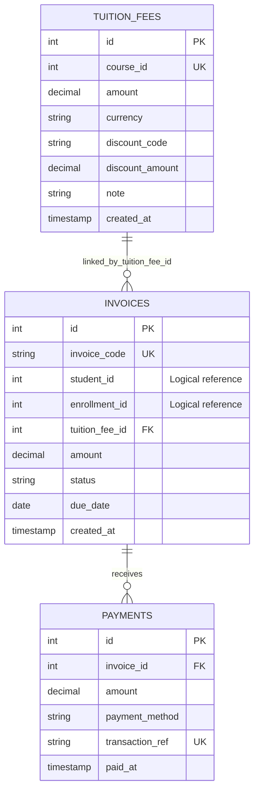

# ĐẶC TẢ CƠ SỞ DỮ LIỆU & TỪ ĐIỂN DỮ LIỆU (DATABASE SCHEMA SPECIFICATION)
## SCHEMA: `finance` (POSTGRESQL 16)

> **Dự án:** Hệ thống Quản lý Trung tâm Anh ngữ  
> **Dịch vụ sở hữu:** Finance Service (port nội bộ 8084)  
> **Hệ quản trị CSDL:** PostgreSQL 16  
> **Schema:** `finance`  
> **Phiên bản:** 1.0  
> **Nguồn:** `scripts/init-db.sql` và `Finance_Module.docx`.

---

## MỤC LỤC
1. [Triết lý Thiết kế & Ranh giới Dữ liệu](#1-triết-lý-thiết-kế--ranh-giới-dữ-liệu)
2. [Sơ đồ Thực thể Quan hệ (ERD)](#2-sơ-đồ-thực-thể-quan-hệ-erd)
3. [Từ điển Dữ liệu Chi tiết của Schema MVP](#3-từ-điển-dữ-liệu-chi-tiết-của-schema-mvp)
4. [Mô hình Schema Mục tiêu trong Finance Module](#4-mô-hình-schema-mục-tiêu-trong-finance-module)
5. [Toàn văn DDL hiện tại trong scripts/init-db.sql](#5-toàn-văn-ddl-hiện-tại-trong-scriptsinit-dbsql)
6. [Quy tắc Ràng buộc & Migration](#6-quy-tắc-ràng-buộc--migration)

---

## 1. Triết lý Thiết kế & Ranh giới Dữ liệu

### 1.1. Schema-per-Service
Finance Service sở hữu và chỉ chịu trách nhiệm đọc/ghi schema `finance`. Việc chia schema phân định quyền sở hữu dữ liệu giữa Admission, Student, Learning và Finance.

### 1.2. Logical References và Physical Foreign Keys
- `tuition_fees.course_id`: logical reference tới `admission.courses(id)`.
- `invoices.student_id`: logical reference tới dữ liệu học viên.
- `invoices.enrollment_id`: logical reference tới đơn đăng ký.
- Không khai báo FK vật lý chéo schema cho các ID trên.
- `invoices.tuition_fee_id` là FK vật lý nội bộ tới `finance.tuition_fees(id)`.
- `payments.invoice_id` là FK vật lý nội bộ tới `finance.invoices(id)`.

### 1.3. Quy ước dữ liệu
- PK: `SERIAL` (integer auto-increment).
- Tên bảng/cột: lowercase `snake_case`.
- Tiền: `NUMERIC(12,2)`; currency mặc định `VND`.
- Thời gian: DDL hiện tại dùng `TIMESTAMPTZ`.
- Invoice status hiện tại: `UNPAID`, `PAID`, `CANCELLED`, `OVERDUE`.
- Payment method hiện tại: `CASH`, `BANK_TRANSFER`.

---

## 2. Sơ đồ Thực thể Quan hệ (ERD)



Quan hệ:
- Một biểu phí có thể được nhiều hóa đơn tham chiếu; DDL không đặt UNIQUE trên `invoices.tuition_fee_id`.
- Một hóa đơn có thể có nhiều lần thanh toán.
- `student_id`, `enrollment_id`, `course_id` không có FK vật lý chéo schema.

---

## 3. Từ điển Dữ liệu Chi tiết của Schema MVP

### 3.1. Bảng `finance.tuition_fees`

**Mục đích:** Lưu biểu phí theo khóa học, mã giảm giá và số tiền giảm. Hiện tại mỗi `course_id` chỉ có một bản ghi do UNIQUE.

| Tên cột | Kiểu dữ liệu | Nullable | Mặc định | Ràng buộc | Diễn giải |
|---|---|:---:|---|---|---|
| `id` | `SERIAL` | NO | Auto-gen | PK | ID biểu phí. |
| `course_id` | `INTEGER` | NO | – | UNIQUE | ID khóa học tham chiếu logic tới Admission. |
| `amount` | `NUMERIC(12,2)` | NO | – | CHECK > 0 | Học phí chuẩn. |
| `currency` | `VARCHAR(10)` | NO | `VND` | – | Đơn vị tiền tệ. |
| `discount_code` | `VARCHAR(50)` | YES | NULL | – | Mã giảm giá đang gắn với biểu phí. |
| `discount_amount` | `NUMERIC(12,2)` | NO | 0 | CHECK >= 0 | Số tiền giảm; backend kiểm tra không vượt học phí. |
| `note` | `TEXT` | YES | NULL | – | Ghi chú chính sách biểu phí. |
| `created_at` | `TIMESTAMPTZ` | NO | `NOW()` | – | Thời điểm tạo bản ghi. |

### 3.2. Bảng `finance.invoices`

**Mục đích:** Lưu nghĩa vụ học phí phải thu của học viên, mã hóa đơn, ngày đến hạn và trạng thái.

| Tên cột | Kiểu dữ liệu | Nullable | Mặc định | Ràng buộc | Diễn giải |
|---|---|:---:|---|---|---|
| `id` | `SERIAL` | NO | Auto-gen | PK | ID hóa đơn. |
| `invoice_code` | `VARCHAR(50)` | NO | – | UNIQUE | Mã hóa đơn. |
| `student_id` | `INTEGER` | NO | – | Logical reference | ID học viên từ service sở hữu hồ sơ. |
| `enrollment_id` | `INTEGER` | YES | NULL | Logical reference | ID đơn đăng ký từ Admission. |
| `tuition_fee_id` | `INTEGER` | YES | NULL | FK | Tham chiếu biểu phí trong Finance. |
| `amount` | `NUMERIC(12,2)` | NO | – | CHECK > 0 | Tổng nghĩa vụ của hóa đơn trong MVP. |
| `status` | `VARCHAR(20)` | NO | `UNPAID` | CHECK | `UNPAID`, `PAID`, `CANCELLED`, `OVERDUE`. |
| `due_date` | `DATE` | NO | – | – | Ngày đến hạn thanh toán. |
| `created_at` | `TIMESTAMPTZ` | NO | `NOW()` | – | Thời điểm tạo hóa đơn. |

**Lưu ý API/DDL:** Pydantic `InvoiceCreate.due_date` khai báo Optional nhưng DDL đặt NOT NULL. Cần thống nhất trước khi triển khai rộng.

### 3.3. Bảng `finance.payments`

**Mục đích:** Lưu từng khoản tiền thu cho hóa đơn. Một hóa đơn có thể có nhiều giao dịch thanh toán.

| Tên cột | Kiểu dữ liệu | Nullable | Mặc định | Ràng buộc | Diễn giải |
|---|---|:---:|---|---|---|
| `id` | `SERIAL` | NO | Auto-gen | PK | ID giao dịch thanh toán. |
| `invoice_id` | `INTEGER` | NO | – | FK | Tham chiếu `finance.invoices(id)`; DDL dùng ON DELETE CASCADE. |
| `amount` | `NUMERIC(12,2)` | NO | – | CHECK > 0 | Số tiền giao dịch. |
| `payment_method` | `VARCHAR(30)` | NO | – | CHECK | `CASH` hoặc `BANK_TRANSFER`. |
| `transaction_ref` | `VARCHAR(100)` | NO | – | UNIQUE | Mã giao dịch duy nhất chống ghi nhận lặp. |
| `paid_at` | `TIMESTAMPTZ` | NO | `NOW()` | – | Thời điểm ghi nhận thanh toán. |

---

## 4. Mô hình Schema Mục tiêu trong Finance Module

Finance_Module.docx mô tả mô hình mở rộng gồm 8 bảng. Đây là **mô hình mục tiêu**, không phải DDL hiện trạng trong `scripts/init-db.sql`.

| STT | Bảng mục tiêu | Vai trò |
|---:|---|---|
| 1 | `finance.vouchers` | Chiến dịch Voucher độc lập, điều kiện và hạn mức sử dụng. |
| 2 | `finance.invoices` | Hóa đơn có loại, giảm giá, số đã thu và số còn phải thu. |
| 3 | `finance.invoice_items` | Chi tiết gói học phí và phí học lại. |
| 4 | `finance.installments` | Lịch đóng phí nhiều đợt. |
| 5 | `finance.payments` | CASH/VIETQR/WALLET_OFFSET và tham chiếu giao dịch ngân hàng. |
| 6 | `finance.student_wallets` | Số dư ví bảo lưu. |
| 7 | `finance.wallet_transactions` | Sổ giao dịch tăng/giảm ví. |
| 8 | `finance.refund_requests` | Yêu cầu hoàn tiền và phê duyệt 3 cấp. |

### 4.1. Data Dictionary rút gọn theo mô hình mục tiêu

| Bảng | Các cột được nêu trong Finance_Module.docx |
|---|---|
| `vouchers` | `id`, `code`, `campaign_name`, `discount_percent`, `discount_amount`, `min_order_value`, `max_discount_amount`, `max_uses`, `current_uses`, `valid_from`, `expires_at`, `is_active`, `created_at` |
| `invoices` | `id`, `invoice_code`, `student_id`, `course_id`, `enrollment_id`, `invoice_type`, `amount`, `voucher_id`, `discount_applied`, `final_amount`, `paid_amount`, `remaining_amount`, `status`, `notes`, `created_at`, `paid_at` |
| `invoice_items` | `id`, `invoice_id`, `course_id`, `item_type`, `description`, `quantity`, `unit_price`, `line_total`, `created_at` |
| `installments` | `id`, `invoice_id`, `installment_no`, `payment_ref_code`, `amount_due`, `amount_paid`, `due_date`, `status`, `paid_at`, `created_at` |
| `payments` | `id`, `payment_code`, `invoice_id`, `installment_id`, `payment_method`, `amount`, `bank_transaction_id`, `qr_reference_code`, `webhook_payload`, `received_by_staff_id`, `status`, `paid_at` |
| `student_wallets` | `id`, `student_id`, `balance`, `is_withdrawable`, `status`, `updated_at` |
| `wallet_transactions` | `id`, `wallet_id`, `tx_type`, `amount`, `related_invoice_id`, `reason`, `created_by_staff_id`, `created_at` |
| `refund_requests` | `id`, `refund_code`, `invoice_id`, `student_id`, `class_id`, `total_sessions`, `attended_sessions`, `max_allowed_sessions`, `paid_amount_snapshot`, `refundable_percent`, `deduction_amount`, `requested_refund_amount`, `approved_refund_amount`, `reason`, thông tin ngân hàng, các trường phê duyệt và trạng thái |

### 4.2. BI Views mục tiêu
- `finance.vw_bi_cash_revenue_monthly`: tổng hợp tiền mặt, chuyển khoản, gross cash-in, tiền hoàn và net cash revenue theo tháng.
- `finance.vw_bi_voucher_campaigns`: tổng hợp lượt dùng Voucher, số hóa đơn, tổng giảm giá và tiền thu từ hóa đơn áp dụng Voucher.

Hai views này chưa có trong `scripts/init-db.sql` hiện tại.

---

## 5. Toàn văn DDL hiện tại trong scripts/init-db.sql

Đoạn dưới đây phản ánh cấu trúc Finance được kiểm tra trong repository `main`.

```sql
CREATE SCHEMA IF NOT EXISTS finance;

CREATE TABLE IF NOT EXISTS finance.tuition_fees (
    id SERIAL PRIMARY KEY,
    course_id INTEGER NOT NULL UNIQUE,
    amount NUMERIC(12, 2) NOT NULL CHECK (amount > 0),
    currency VARCHAR(10) NOT NULL DEFAULT 'VND',
    discount_code VARCHAR(50),
    discount_amount NUMERIC(12, 2) NOT NULL DEFAULT 0 CHECK (discount_amount >= 0),
    note TEXT,
    created_at TIMESTAMPTZ NOT NULL DEFAULT NOW()
);

CREATE TABLE IF NOT EXISTS finance.invoices (
    id SERIAL PRIMARY KEY,
    invoice_code VARCHAR(50) NOT NULL UNIQUE,
    student_id INTEGER NOT NULL,
    enrollment_id INTEGER,
    tuition_fee_id INTEGER REFERENCES finance.tuition_fees(id) ON DELETE SET NULL,
    amount NUMERIC(12, 2) NOT NULL CHECK (amount > 0),
    status VARCHAR(20) NOT NULL DEFAULT 'UNPAID'
        CHECK (status IN ('UNPAID', 'PAID', 'CANCELLED', 'OVERDUE')),
    due_date DATE NOT NULL,
    created_at TIMESTAMPTZ NOT NULL DEFAULT NOW()
);

CREATE TABLE IF NOT EXISTS finance.payments (
    id SERIAL PRIMARY KEY,
    invoice_id INTEGER NOT NULL REFERENCES finance.invoices(id) ON DELETE CASCADE,
    amount NUMERIC(12, 2) NOT NULL CHECK (amount > 0),
    payment_method VARCHAR(30) NOT NULL
        CHECK (payment_method IN ('CASH', 'BANK_TRANSFER')),
    transaction_ref VARCHAR(100) NOT NULL UNIQUE,
    paid_at TIMESTAMPTZ NOT NULL DEFAULT NOW()
);
```

### 5.1. Startup migration trong backend

`services/finance/backend/main.py` có startup routine:
- Kiểm tra cột `tuition_fee_id` trong `finance.invoices`; nếu chưa có thì ALTER TABLE để thêm cột và FK nội bộ tới `finance.tuition_fees(id)`.
- Kiểm tra constraint UNIQUE `payments_transaction_ref_key`; nếu chưa có thì bổ sung UNIQUE cho `transaction_ref`.
- Migration lỗi sẽ rollback và in cảnh báo; không thể kết luận migration đã chạy thành công ở mọi môi trường chỉ từ mã nguồn.

---

## 6. Quy tắc Ràng buộc & Migration

### 6.1. Ràng buộc đã có
- `tuition_fees.course_id` UNIQUE.
- `tuition_fees.amount > 0`.
- `tuition_fees.discount_amount >= 0`.
- `invoices.invoice_code` UNIQUE.
- `invoices.amount > 0`.
- `invoices.status` thuộc tập trạng thái cho phép.
- `payments.amount > 0`.
- `payments.payment_method` thuộc `CASH`, `BANK_TRANSFER`.
- `payments.transaction_ref` UNIQUE.
- FK nội bộ `payments.invoice_id` và `invoices.tuition_fee_id`.

### 6.2. Các điểm cần thống nhất trước khi mở rộng
- `InvoiceCreate.due_date` Optional nhưng cột DDL NOT NULL.
- `tuition_fees` UNIQUE `course_id`, chưa lưu lịch sử nhiều phiên bản biểu phí cho cùng khóa.
- Backend cho phép request truyền `amount` ghi đè giá biểu phí; cần chốt chính sách.
- DDL `payments.invoice_id` dùng ON DELETE CASCADE; nghiệp vụ tài chính nên cân nhắc bảo toàn lịch sử thay vì xóa payment theo invoice.
- Chưa có `updated_at`, versioning, audit trail, currency conversion.
- Chưa có migration chính thức từ 3 bảng MVP sang mô hình mục tiêu 8 bảng.

**Nguyên tắc migration:** Backup trước khi thay đổi; lập mapping trường cũ; không xóa dữ liệu payment; chạy thử trên bản sao DB; xác minh số lượng và tổng tiền trước/sau; chuẩn bị rollback.
