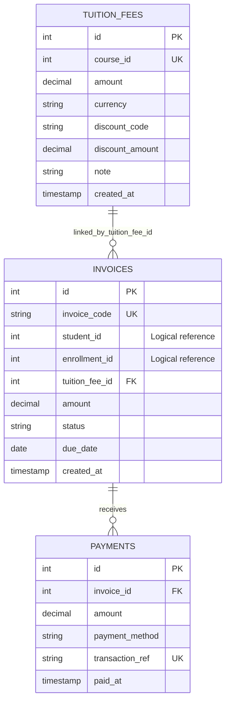

# ĐẶC TẢ CƠ SỞ DỮ LIỆU & TỪ ĐIỂN DỮ LIỆU (DATABASE SCHEMA SPECIFICATION)
## SCHEMA: `finance` (POSTGRESQL 16)

> **Dự án:** Hệ thống Quản lý Trung tâm Anh ngữ  
> **Dịch vụ sở hữu:** Finance Service (port nội bộ 8084)  
> **Hệ quản trị CSDL:** PostgreSQL 16  
> **Schema:** `finance`  
> **Phiên bản:** 1.0  

---

## MỤC LỤC
1. [Triết lý Thiết kế & Ranh giới Dữ liệu](#1-triết-lý-thiết-kế--ranh-giới-dữ-liệu)
2. [Sơ đồ Thực thể Quan hệ (ERD)](#2-sơ-đồ-thực-thể-quan-hệ-erd)
3. [Từ điển Dữ liệu của các Bảng Khởi tạo](#3-từ-điển-dữ-liệu-của-các-bảng-khởi-tạo)
4. [Mô hình Dữ liệu Mở rộng của Finance](#4-mô-hình-dữ-liệu-mở-rộng-của-finance)
   - 4.1. Danh mục thuộc tính
   - 4.2. BI Views
   - 4.3. Toàn văn DDL của mô hình dữ liệu Finance
5. [DDL khởi tạo trong scripts/init-db.sql](#5-ddl-khởi-tạo-hiện-có-trong-scriptsinit-dbsql)
6. [Quy tắc Ràng buộc & Migration](#6-quy-tắc-ràng-buộc--migration)

---

## 1. Triết lý Thiết kế & Ranh giới Dữ liệu

### 1.1. Schema-per-Service
Finance Service sở hữu và chỉ chịu trách nhiệm đọc/ghi schema `finance`. Việc chia schema phân định quyền sở hữu dữ liệu giữa Admission, Student, Learning và Finance.

### 1.2. Logical References và Physical Foreign Keys
- `tuition_fees.course_id`: logical reference tới `admission.courses(id)`.
- `invoices.student_id`: logical reference tới dữ liệu học viên.
- `invoices.enrollment_id`: logical reference tới đơn đăng ký.
- Không khai báo FK vật lý chéo schema cho các ID trên.
- `invoices.tuition_fee_id` là FK vật lý nội bộ tới `finance.tuition_fees(id)`.
- `payments.invoice_id` là FK vật lý nội bộ tới `finance.invoices(id)`.

### 1.3. Quy ước dữ liệu
- PK: `SERIAL` (integer auto-increment).
- Tên bảng/cột: lowercase `snake_case`.
- Tiền: `NUMERIC(12,2)`; currency mặc định `VND`.
- Thời gian: DDL hiện tại dùng `TIMESTAMPTZ`.
- Invoice status hiện tại: `UNPAID`, `PAID`, `CANCELLED`, `OVERDUE`.
- Payment method hiện tại: `CASH`, `BANK_TRANSFER`.

---

## 2. Sơ đồ Thực thể Quan hệ (ERD)



Quan hệ:
- Một biểu phí có thể được nhiều hóa đơn tham chiếu; DDL không đặt UNIQUE trên `invoices.tuition_fee_id`.
- Một hóa đơn có thể có nhiều lần thanh toán.
- `student_id`, `enrollment_id`, `course_id` không có FK vật lý chéo schema.

---

## 3. Từ điển Dữ liệu của các Bảng Khởi tạo

### 3.1. Bảng `finance.tuition_fees`

**Mục đích:** Lưu biểu phí theo khóa học, mã giảm giá và số tiền giảm. Hiện tại mỗi `course_id` chỉ có một bản ghi do UNIQUE.

| Tên cột | Kiểu dữ liệu | Nullable | Mặc định | Ràng buộc | Diễn giải |
|---|---|:---:|---|---|---|
| `id` | `SERIAL` | NO | Auto-gen | PK | ID biểu phí. |
| `course_id` | `INTEGER` | NO | – | UNIQUE | ID khóa học tham chiếu logic tới Admission. |
| `amount` | `NUMERIC(12,2)` | NO | – | CHECK > 0 | Học phí chuẩn. |
| `currency` | `VARCHAR(10)` | NO | `VND` | – | Đơn vị tiền tệ. |
| `discount_code` | `VARCHAR(50)` | YES | NULL | – | Mã giảm giá đang gắn với biểu phí. |
| `discount_amount` | `NUMERIC(12,2)` | NO | 0 | CHECK >= 0 | Số tiền giảm; backend kiểm tra không vượt học phí. |
| `note` | `TEXT` | YES | NULL | – | Ghi chú chính sách biểu phí. |
| `created_at` | `TIMESTAMPTZ` | NO | `NOW()` | – | Thời điểm tạo bản ghi. |

### 3.2. Bảng `finance.invoices`

**Mục đích:** Lưu nghĩa vụ học phí phải thu của học viên, mã hóa đơn, ngày đến hạn và trạng thái.

| Tên cột | Kiểu dữ liệu | Nullable | Mặc định | Ràng buộc | Diễn giải |
|---|---|:---:|---|---|---|
| `id` | `SERIAL` | NO | Auto-gen | PK | ID hóa đơn. |
| `invoice_code` | `VARCHAR(50)` | NO | – | UNIQUE | Mã hóa đơn. |
| `student_id` | `INTEGER` | NO | – | Logical reference | ID học viên từ service sở hữu hồ sơ. |
| `enrollment_id` | `INTEGER` | YES | NULL | Logical reference | ID đơn đăng ký từ Admission. |
| `tuition_fee_id` | `INTEGER` | YES | NULL | FK | Tham chiếu biểu phí trong Finance. |
| `amount` | `NUMERIC(12,2)` | NO | – | CHECK > 0 | Tổng nghĩa vụ thanh toán của hóa đơn. |
| `status` | `VARCHAR(20)` | NO | `UNPAID` | CHECK | `UNPAID`, `PAID`, `CANCELLED`, `OVERDUE`. |
| `due_date` | `DATE` | NO | – | – | Ngày đến hạn thanh toán. |
| `created_at` | `TIMESTAMPTZ` | NO | `NOW()` | – | Thời điểm tạo hóa đơn. |

**Lưu ý API/DDL:** Pydantic `InvoiceCreate.due_date` khai báo Optional nhưng DDL đặt NOT NULL. Cần thống nhất trước khi triển khai rộng.

### 3.3. Bảng `finance.payments`

**Mục đích:** Lưu từng khoản tiền thu cho hóa đơn. Một hóa đơn có thể có nhiều giao dịch thanh toán.

| Tên cột | Kiểu dữ liệu | Nullable | Mặc định | Ràng buộc | Diễn giải |
|---|---|:---:|---|---|---|
| `id` | `SERIAL` | NO | Auto-gen | PK | ID giao dịch thanh toán. |
| `invoice_id` | `INTEGER` | NO | – | FK | Tham chiếu `finance.invoices(id)`; DDL dùng ON DELETE CASCADE. |
| `amount` | `NUMERIC(12,2)` | NO | – | CHECK > 0 | Số tiền giao dịch. |
| `payment_method` | `VARCHAR(30)` | NO | – | CHECK | `CASH` hoặc `BANK_TRANSFER`. |
| `transaction_ref` | `VARCHAR(100)` | NO | – | UNIQUE | Mã giao dịch duy nhất chống ghi nhận lặp. |
| `paid_at` | `TIMESTAMPTZ` | NO | `NOW()` | – | Thời điểm ghi nhận thanh toán. |

---

## 4. Mô hình Dữ liệu Mở rộng của Finance

Mô hình dữ liệu nghiệp vụ Finance gồm 8 bảng, bao quát biểu phí, hóa đơn, các kỳ thanh toán, giao dịch, ví bảo lưu và quy trình hoàn phí.

| STT | Bảng | Vai trò |
|---:|---|---|
| 1 | `finance.vouchers` | Chiến dịch Voucher độc lập, điều kiện và hạn mức sử dụng. |
| 2 | `finance.invoices` | Hóa đơn có loại, giảm giá, số đã thu và số còn phải thu. |
| 3 | `finance.invoice_items` | Chi tiết gói học phí và phí học lại. |
| 4 | `finance.installments` | Lịch đóng phí nhiều đợt. |
| 5 | `finance.payments` | CASH/VIETQR/WALLET_OFFSET và tham chiếu giao dịch ngân hàng. |
| 6 | `finance.student_wallets` | Số dư ví bảo lưu. |
| 7 | `finance.wallet_transactions` | Sổ giao dịch tăng/giảm ví. |
| 8 | `finance.refund_requests` | Yêu cầu hoàn tiền và phê duyệt 3 cấp. |

### 4.1. Danh mục thuộc tính của mô hình dữ liệu mở rộng

| Bảng | Các cột nghiệp vụ |
|---|---|
| `vouchers` | `id`, `code`, `campaign_name`, `discount_percent`, `discount_amount`, `min_order_value`, `max_discount_amount`, `max_uses`, `current_uses`, `valid_from`, `expires_at`, `is_active`, `created_at` |
| `invoices` | `id`, `invoice_code`, `student_id`, `course_id`, `enrollment_id`, `invoice_type`, `amount`, `voucher_id`, `discount_applied`, `final_amount`, `paid_amount`, `remaining_amount`, `status`, `notes`, `created_at`, `paid_at` |
| `invoice_items` | `id`, `invoice_id`, `course_id`, `item_type`, `description`, `quantity`, `unit_price`, `line_total`, `created_at` |
| `installments` | `id`, `invoice_id`, `installment_no`, `payment_ref_code`, `amount_due`, `amount_paid`, `due_date`, `status`, `paid_at`, `created_at` |
| `payments` | `id`, `payment_code`, `invoice_id`, `installment_id`, `payment_method`, `amount`, `bank_transaction_id`, `qr_reference_code`, `webhook_payload`, `received_by_staff_id`, `status`, `paid_at` |
| `student_wallets` | `id`, `student_id`, `balance`, `is_withdrawable`, `status`, `updated_at` |
| `wallet_transactions` | `id`, `wallet_id`, `tx_type`, `amount`, `related_invoice_id`, `reason`, `created_by_staff_id`, `created_at` |
| `refund_requests` | `id`, `refund_code`, `invoice_id`, `student_id`, `class_id`, `total_sessions`, `attended_sessions`, `max_allowed_sessions`, `paid_amount_snapshot`, `refundable_percent`, `deduction_amount`, `requested_refund_amount`, `approved_refund_amount`, `reason`, thông tin ngân hàng, các trường phê duyệt và trạng thái |

### 4.2. BI Views nghiệp vụ
- `finance.vw_bi_cash_revenue_monthly`: tổng hợp tiền mặt, chuyển khoản, gross cash-in, tiền hoàn và net cash revenue theo tháng.
- `finance.vw_bi_voucher_campaigns`: tổng hợp lượt dùng Voucher, số hóa đơn, tổng giảm giá và tiền thu từ hóa đơn áp dụng Voucher.


---


### 4.3. Toàn văn DDL của mô hình dữ liệu Finance

```sql
-- ============================================================================
-- FINANCE SERVICE SCHEMA DDL (PostgreSQL 16)
-- Primary Key / Logical Foreign Key: SERIAL / INTEGER
-- ============================================================================

CREATE SCHEMA IF NOT EXISTS finance;

-- 1. BẢNG CHIẾN DỊCH VOUCHER
CREATE TABLE IF NOT EXISTS finance.vouchers (
    id SERIAL PRIMARY KEY,
    code VARCHAR(50) UNIQUE NOT NULL,
    campaign_name VARCHAR(150) NOT NULL DEFAULT 'Chiến dịch ưu đãi học phí',
    discount_percent INT DEFAULT 0 CHECK (discount_percent >= 0 AND discount_percent <= 100),
    discount_amount DECIMAL(12, 2) DEFAULT 0 CHECK (discount_amount >= 0),
    min_order_value DECIMAL(12, 2) DEFAULT 0 CHECK (min_order_value >= 0),
    max_discount_amount DECIMAL(12, 2) DEFAULT NULL,
    max_uses INT DEFAULT 100 CHECK (max_uses > 0),
    current_uses INT DEFAULT 0 CHECK (current_uses >= 0),
    valid_from TIMESTAMP DEFAULT CURRENT_TIMESTAMP,
    expires_at TIMESTAMP NOT NULL,
    is_active BOOLEAN DEFAULT TRUE,
    created_at TIMESTAMP DEFAULT CURRENT_TIMESTAMP,
    CONSTRAINT chk_voucher_usage_limit CHECK (current_uses <= max_uses)
);

-- 2. BẢNG HÓA ĐƠN
CREATE TABLE IF NOT EXISTS finance.invoices (
    id SERIAL PRIMARY KEY,
    invoice_code VARCHAR(50) UNIQUE NOT NULL,
    student_id INT NOT NULL,
    course_id INT NOT NULL,
    enrollment_id INT,
    invoice_type VARCHAR(30) NOT NULL DEFAULT 'COURSE_PACKAGE'
        CHECK (invoice_type IN ('COURSE_PACKAGE', 'STANDALONE_RETAKE', 'MIXED')),
    amount DECIMAL(12, 2) NOT NULL CHECK (amount >= 0),
    voucher_id INT REFERENCES finance.vouchers(id),
    discount_applied DECIMAL(12, 2) DEFAULT 0 CHECK (discount_applied >= 0),
    final_amount DECIMAL(12, 2) NOT NULL CHECK (final_amount >= 0),
    paid_amount DECIMAL(12, 2) NOT NULL DEFAULT 0 CHECK (paid_amount >= 0),
    remaining_amount DECIMAL(12, 2) GENERATED ALWAYS AS (final_amount - paid_amount) STORED,
    status VARCHAR(20) NOT NULL DEFAULT 'PENDING'
        CHECK (status IN ('PENDING', 'PARTIAL', 'PAID', 'CANCELLED', 'REFUNDED')),
    notes TEXT,
    created_at TIMESTAMP DEFAULT CURRENT_TIMESTAMP,
    paid_at TIMESTAMP,
    CONSTRAINT chk_invoice_math CHECK (final_amount = amount - discount_applied),
    CONSTRAINT chk_invoice_paid_bound CHECK (paid_amount <= final_amount)
);

-- 3. BẢNG CHI TIẾT KHOẢN MỤC HÓA ĐƠN
CREATE TABLE IF NOT EXISTS finance.invoice_items (
    id SERIAL PRIMARY KEY,
    invoice_id INT NOT NULL REFERENCES finance.invoices(id) ON DELETE CASCADE,
    course_id INT,
    item_type VARCHAR(30) NOT NULL
        CHECK (item_type IN ('TUITION_PACKAGE', 'RETAKE_FEE')),
    description VARCHAR(255) NOT NULL,
    quantity INT NOT NULL DEFAULT 1 CHECK (quantity > 0),
    unit_price DECIMAL(12, 2) NOT NULL CHECK (unit_price >= 0),
    line_total DECIMAL(12, 2) NOT NULL CHECK (line_total >= 0),
    created_at TIMESTAMP DEFAULT CURRENT_TIMESTAMP,
    CONSTRAINT chk_line_total_math CHECK (line_total = quantity * unit_price)
);

-- 4. BẢNG LỊCH ĐÓNG HỌC PHÍ NHIỀU ĐỢT
CREATE TABLE IF NOT EXISTS finance.installments (
    id SERIAL PRIMARY KEY,
    invoice_id INT NOT NULL REFERENCES finance.invoices(id) ON DELETE CASCADE,
    installment_no INT NOT NULL CHECK (installment_no >= 1),
    payment_ref_code VARCHAR(50) UNIQUE NOT NULL,
    amount_due DECIMAL(12, 2) NOT NULL CHECK (amount_due > 0),
    amount_paid DECIMAL(12, 2) NOT NULL DEFAULT 0 CHECK (amount_paid >= 0),
    due_date DATE NOT NULL,
    status VARCHAR(20) NOT NULL DEFAULT 'PENDING'
        CHECK (status IN ('PENDING', 'PARTIAL', 'PAID', 'OVERDUE', 'CANCELLED')),
    paid_at TIMESTAMP,
    created_at TIMESTAMP DEFAULT CURRENT_TIMESTAMP,
    UNIQUE (invoice_id, installment_no)
);

-- 5. BẢNG GIAO DỊCH THANH TOÁN
CREATE TABLE IF NOT EXISTS finance.payments (
    id SERIAL PRIMARY KEY,
    payment_code VARCHAR(50) UNIQUE NOT NULL,
    invoice_id INT NOT NULL REFERENCES finance.invoices(id),
    installment_id INT REFERENCES finance.installments(id),
    payment_method VARCHAR(20) NOT NULL
        CHECK (payment_method IN ('CASH', 'VIETQR', 'WALLET_OFFSET')),
    amount DECIMAL(12, 2) NOT NULL CHECK (amount > 0),
    bank_transaction_id VARCHAR(100) UNIQUE,
    qr_reference_code VARCHAR(50),
    webhook_payload JSONB,
    received_by_staff_id INT,
    status VARCHAR(20) NOT NULL DEFAULT 'SUCCESS'
        CHECK (status IN ('PENDING', 'SUCCESS', 'FAILED')),
    paid_at TIMESTAMP DEFAULT CURRENT_TIMESTAMP
);

-- 6. BẢNG VÍ BẢO LƯU HỌC VIÊN
CREATE TABLE IF NOT EXISTS finance.student_wallets (
    id SERIAL PRIMARY KEY,
    student_id INT UNIQUE NOT NULL,
    balance DECIMAL(12, 2) NOT NULL DEFAULT 0 CHECK (balance >= 0),
    is_withdrawable BOOLEAN NOT NULL DEFAULT FALSE,
    status VARCHAR(20) NOT NULL DEFAULT 'ACTIVE'
        CHECK (status IN ('ACTIVE', 'FROZEN')),
    updated_at TIMESTAMP DEFAULT CURRENT_TIMESTAMP
);

-- 7. BẢNG LỊCH SỬ GIAO DỊCH VÍ
CREATE TABLE IF NOT EXISTS finance.wallet_transactions (
    id SERIAL PRIMARY KEY,
    wallet_id INT NOT NULL REFERENCES finance.student_wallets(id),
    tx_type VARCHAR(30) NOT NULL
        CHECK (tx_type IN ('RESERVATION_CREDIT', 'TUITION_OFFSET', 'ADJUSTMENT')),
    amount DECIMAL(12, 2) NOT NULL CHECK (amount > 0),
    related_invoice_id INT REFERENCES finance.invoices(id),
    reason TEXT NOT NULL,
    created_by_staff_id INT,
    created_at TIMESTAMP DEFAULT CURRENT_TIMESTAMP
);

-- 8. BẢNG YÊU CẦU VÀ PHÊ DUYỆT HOÀN TIỀN
CREATE TABLE IF NOT EXISTS finance.refund_requests (
    id SERIAL PRIMARY KEY,
    refund_code VARCHAR(50) UNIQUE NOT NULL,
    invoice_id INT NOT NULL REFERENCES finance.invoices(id),
    student_id INT NOT NULL,
    class_id INT,
    total_sessions INT NOT NULL CHECK (total_sessions > 0),
    attended_sessions INT NOT NULL CHECK (attended_sessions >= 0),
    max_allowed_sessions INT NOT NULL DEFAULT 3,
    paid_amount_snapshot DECIMAL(12, 2) NOT NULL,
    refundable_percent INT NOT NULL CHECK (refundable_percent BETWEEN 0 AND 100),
    deduction_amount DECIMAL(12, 2) NOT NULL DEFAULT 0,
    requested_refund_amount DECIMAL(12, 2) NOT NULL CHECK (requested_refund_amount >= 0),
    approved_refund_amount DECIMAL(12, 2) CHECK (approved_refund_amount >= 0),
    reason TEXT NOT NULL,
    bank_name VARCHAR(100),
    bank_account_no VARCHAR(50),
    bank_account_holder VARCHAR(150),
    status VARCHAR(30) NOT NULL DEFAULT 'PENDING_ACCOUNTANT'
        CHECK (status IN (
            'PENDING_ACCOUNTANT',
            'PENDING_DIRECTOR',
            'APPROVED',
            'REJECTED',
            'COMPLETED'
        )),
    requested_by_staff_id INT NOT NULL,
    requested_at TIMESTAMP DEFAULT CURRENT_TIMESTAMP,
    verified_by_accountant_id INT,
    verified_at TIMESTAMP,
    accountant_note TEXT,
    approved_by_director_id INT,
    approved_at TIMESTAMP,
    director_note TEXT,
    completed_at TIMESTAMP,
    CONSTRAINT chk_valid_early_withdrawal CHECK (attended_sessions <= max_allowed_sessions)
);

-- VIEW 1: BÁO CÁO DOANH THU THỰC THU VÀ HOÀN PHÍ THEO THÁNG
CREATE OR REPLACE VIEW finance.vw_bi_cash_revenue_monthly AS
WITH cash_in AS (
    SELECT
        DATE_TRUNC('month', paid_at) AS report_month,
        SUM(CASE WHEN payment_method = 'CASH' THEN amount ELSE 0 END) AS cash_at_counter,
        SUM(CASE WHEN payment_method = 'VIETQR' THEN amount ELSE 0 END) AS vietqr_transfer,
        SUM(CASE WHEN payment_method IN ('CASH', 'VIETQR') THEN amount ELSE 0 END) AS gross_cash_in
    FROM finance.payments
    WHERE status = 'SUCCESS'
    GROUP BY DATE_TRUNC('month', paid_at)
),
cash_refund AS (
    SELECT
        DATE_TRUNC('month', completed_at) AS report_month,
        COUNT(id) AS refund_count,
        SUM(approved_refund_amount) AS total_refunded
    FROM finance.refund_requests
    WHERE status = 'COMPLETED'
    GROUP BY DATE_TRUNC('month', completed_at)
)
SELECT
    COALESCE(ci.report_month, cr.report_month) AS report_month,
    COALESCE(ci.cash_at_counter, 0) AS cash_at_counter,
    COALESCE(ci.vietqr_transfer, 0) AS vietqr_transfer,
    COALESCE(ci.gross_cash_in, 0) AS gross_cash_in,
    COALESCE(cr.refund_count, 0) AS refund_count,
    COALESCE(cr.total_refunded, 0) AS total_refunded,
    (COALESCE(ci.gross_cash_in, 0) - COALESCE(cr.total_refunded, 0)) AS net_cash_revenue,
    CASE
        WHEN COALESCE(ci.gross_cash_in, 0) > 0
        THEN ROUND((COALESCE(cr.total_refunded, 0) / ci.gross_cash_in) * 100, 2)
        ELSE 0
    END AS refund_rate_pct
FROM cash_in ci
FULL OUTER JOIN cash_refund cr ON ci.report_month = cr.report_month
ORDER BY report_month DESC;

-- VIEW 2: BÁO CÁO HIỆU QUẢ CHIẾN DỊCH VOUCHER
CREATE OR REPLACE VIEW finance.vw_bi_voucher_campaigns AS
SELECT
    v.id AS voucher_id,
    v.code,
    v.campaign_name,
    v.discount_percent,
    v.discount_amount,
    v.max_uses,
    v.current_uses,
    ROUND((v.current_uses::DECIMAL / v.max_uses) * 100, 2) AS usage_rate_pct,
    COUNT(i.id) AS total_invoices,
    COALESCE(SUM(i.discount_applied), 0) AS total_discount_given,
    COALESCE(SUM(i.paid_amount), 0) AS actual_cash_collected
FROM finance.vouchers v
LEFT JOIN finance.invoices i ON v.id = i.voucher_id AND i.status != 'CANCELLED'
GROUP BY v.id;
```

## 5. DDL khởi tạo hiện có trong scripts/init-db.sql

Đoạn dưới đây là DDL khởi tạo schema Finance hiện được khai báo trong `scripts/init-db.sql`.

```sql
CREATE SCHEMA IF NOT EXISTS finance;

CREATE TABLE IF NOT EXISTS finance.tuition_fees (
    id SERIAL PRIMARY KEY,
    course_id INTEGER NOT NULL UNIQUE,
    amount NUMERIC(12, 2) NOT NULL CHECK (amount > 0),
    currency VARCHAR(10) NOT NULL DEFAULT 'VND',
    discount_code VARCHAR(50),
    discount_amount NUMERIC(12, 2) NOT NULL DEFAULT 0 CHECK (discount_amount >= 0),
    note TEXT,
    created_at TIMESTAMPTZ NOT NULL DEFAULT NOW()
);

CREATE TABLE IF NOT EXISTS finance.invoices (
    id SERIAL PRIMARY KEY,
    invoice_code VARCHAR(50) NOT NULL UNIQUE,
    student_id INTEGER NOT NULL,
    enrollment_id INTEGER,
    tuition_fee_id INTEGER REFERENCES finance.tuition_fees(id) ON DELETE SET NULL,
    amount NUMERIC(12, 2) NOT NULL CHECK (amount > 0),
    status VARCHAR(20) NOT NULL DEFAULT 'UNPAID'
        CHECK (status IN ('UNPAID', 'PAID', 'CANCELLED', 'OVERDUE')),
    due_date DATE NOT NULL,
    created_at TIMESTAMPTZ NOT NULL DEFAULT NOW()
);

CREATE TABLE IF NOT EXISTS finance.payments (
    id SERIAL PRIMARY KEY,
    invoice_id INTEGER NOT NULL REFERENCES finance.invoices(id) ON DELETE CASCADE,
    amount NUMERIC(12, 2) NOT NULL CHECK (amount > 0),
    payment_method VARCHAR(30) NOT NULL
        CHECK (payment_method IN ('CASH', 'BANK_TRANSFER')),
    transaction_ref VARCHAR(100) NOT NULL UNIQUE,
    paid_at TIMESTAMPTZ NOT NULL DEFAULT NOW()
);
```

### 5.1. Startup migration trong backend

`services/finance/backend/main.py` có startup routine:
- Kiểm tra cột `tuition_fee_id` trong `finance.invoices`; nếu chưa có thì ALTER TABLE để thêm cột và FK nội bộ tới `finance.tuition_fees(id)`.
- Kiểm tra constraint UNIQUE `payments_transaction_ref_key`; nếu chưa có thì bổ sung UNIQUE cho `transaction_ref`.
- Migration lỗi sẽ rollback và in cảnh báo; không thể kết luận migration đã chạy thành công ở mọi môi trường chỉ từ mã nguồn.

---

## 6. Quy tắc Ràng buộc & Migration

### 6.1. Ràng buộc đã có
- `tuition_fees.course_id` UNIQUE.
- `tuition_fees.amount > 0`.
- `tuition_fees.discount_amount >= 0`.
- `invoices.invoice_code` UNIQUE.
- `invoices.amount > 0`.
- `invoices.status` thuộc tập trạng thái cho phép.
- `payments.amount > 0`.
- `payments.payment_method` thuộc `CASH`, `BANK_TRANSFER`.
- `payments.transaction_ref` UNIQUE.
- FK nội bộ `payments.invoice_id` và `invoices.tuition_fee_id`.

### 6.2. Các điểm cần thống nhất trước khi mở rộng
- `InvoiceCreate.due_date` Optional nhưng cột DDL NOT NULL.
- `tuition_fees` UNIQUE `course_id`, chưa lưu lịch sử nhiều phiên bản biểu phí cho cùng khóa.
- Backend cho phép request truyền `amount` ghi đè giá biểu phí; cần chốt chính sách.
- DDL `payments.invoice_id` dùng ON DELETE CASCADE; nghiệp vụ tài chính nên cân nhắc bảo toàn lịch sử thay vì xóa payment theo invoice.
- Chính sách lưu vết thay đổi biểu phí, versioning, audit trail và currency conversion cần được xác định thống nhất với nghiệp vụ tài chính.
- Khi chuyển đổi cấu trúc khởi tạo sang mô hình dữ liệu mở rộng, cần xác định quy tắc mapping dữ liệu, backup và phương án rollback.

**Nguyên tắc migration:** Backup trước khi thay đổi; lập mapping trường cũ; không xóa dữ liệu payment; chạy thử trên bản sao DB; xác minh số lượng và tổng tiền trước/sau; chuẩn bị rollback.
