# ĐẶC TẢ MÔ HÌNH HÓA UML (UML SPECIFICATION)
## FINANCE SERVICE – HỆ THỐNG QUẢN LÝ TRUNG TÂM ANH NGỮ

> **Phân hệ:** Finance Service  
> **Port nội bộ:** 8084 theo `docs/architecture.md`  
> **Schema:** `finance`  
> **Phiên bản:** 1.0

---

## MỤC LỤC
1. [Tổng quan Mô hình hóa](#1-tổng-quan-mô-hình-hóa)
2. [Biểu đồ Ca sử dụng (Use Case)](#2-biểu-đồ-ca-sử-dụng-use-case)
3. [Biểu đồ Lớp (Class Diagram)](#3-biểu-đồ-lớp-class-diagram)
4. [Biểu đồ Tuần tự (Sequence Diagrams)](#4-biểu-đồ-tuần-tự-sequence-diagrams)
5. [Biểu đồ Máy Trạng thái (State Machines)](#5-biểu-đồ-máy-trạng-thái-state-machines)
6. [Biểu đồ Hoạt động (Activity Diagrams)](#6-biểu-đồ-hoạt-động-activity-diagrams)
7. [Ma trận Truy vết Yêu cầu](#7-ma-trận-truy-vết-yêu-cầu)

---

## 1. Tổng quan Mô hình hóa

Mô hình nghiệp vụ Finance gồm các đối tượng TuitionFee, Voucher, Invoice, InvoiceItem, Installment, Payment, StudentWallet, WalletTransaction và RefundRequest.

**Actors:**
- `STUDENT`: học viên tra cứu hóa đơn/thanh toán của bản thân.
- `STAFF`: nhân viên Finance; nghiệp vụ có thể phân tách Tư vấn và Kế toán.
- `ADMIN`: quản trị/giám đốc.
- `ADMISSION_SERVICE`: gửi yêu cầu lập hóa đơn khi chốt đăng ký.
- `LEARNING_SERVICE`: cung cấp dữ liệu buổi học cho quy trình hoàn phí.
- `BANK_WEBHOOK`: gửi kết quả giao dịch VietQR trong quy trình nghiệp vụ.

---

## 2. Biểu đồ Ca sử dụng (Use Case)

### 2.1. Use Case tổng thể

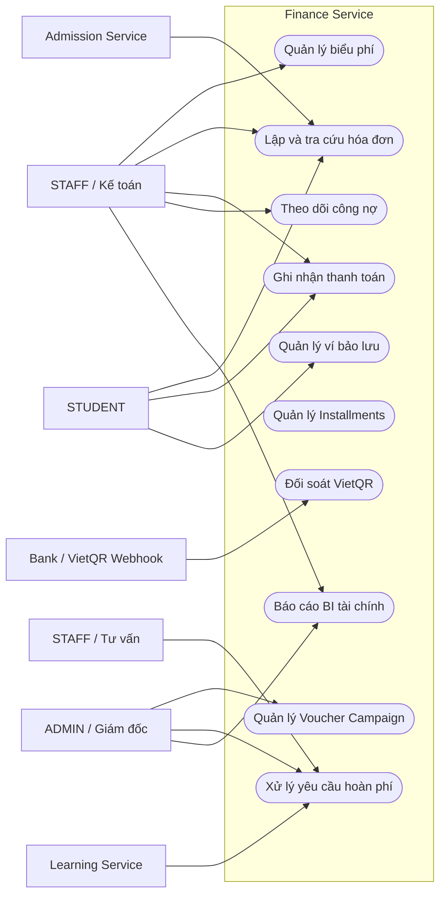

### 2.2. Lập hóa đơn và ghi nhận thanh toán

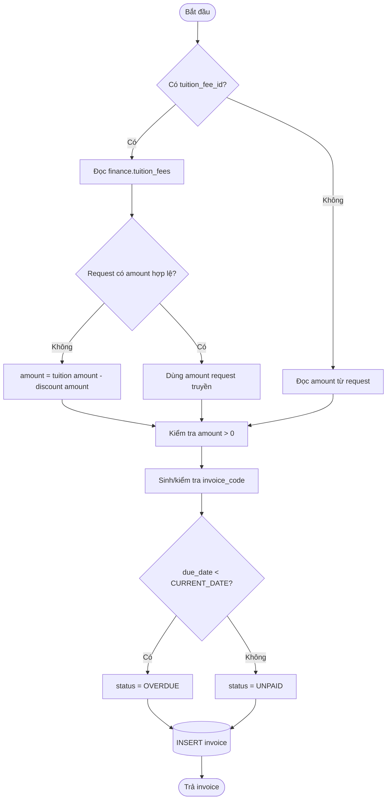

### 2.3. Quy trình hoàn tiền 3 cấp (thiết kế mục tiêu)

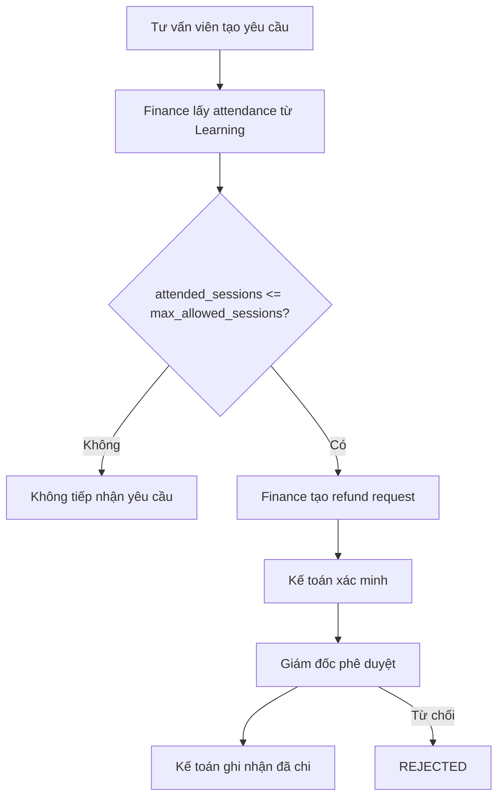

---

## 3. Biểu đồ Lớp (Class Diagram)

### 3.1. Domain Model – Hóa đơn và thanh toán

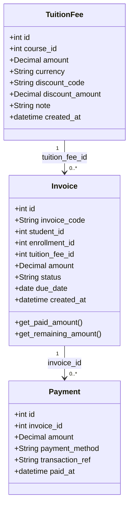

### 3.2. Domain Model – Các nghiệp vụ tài chính mở rộng

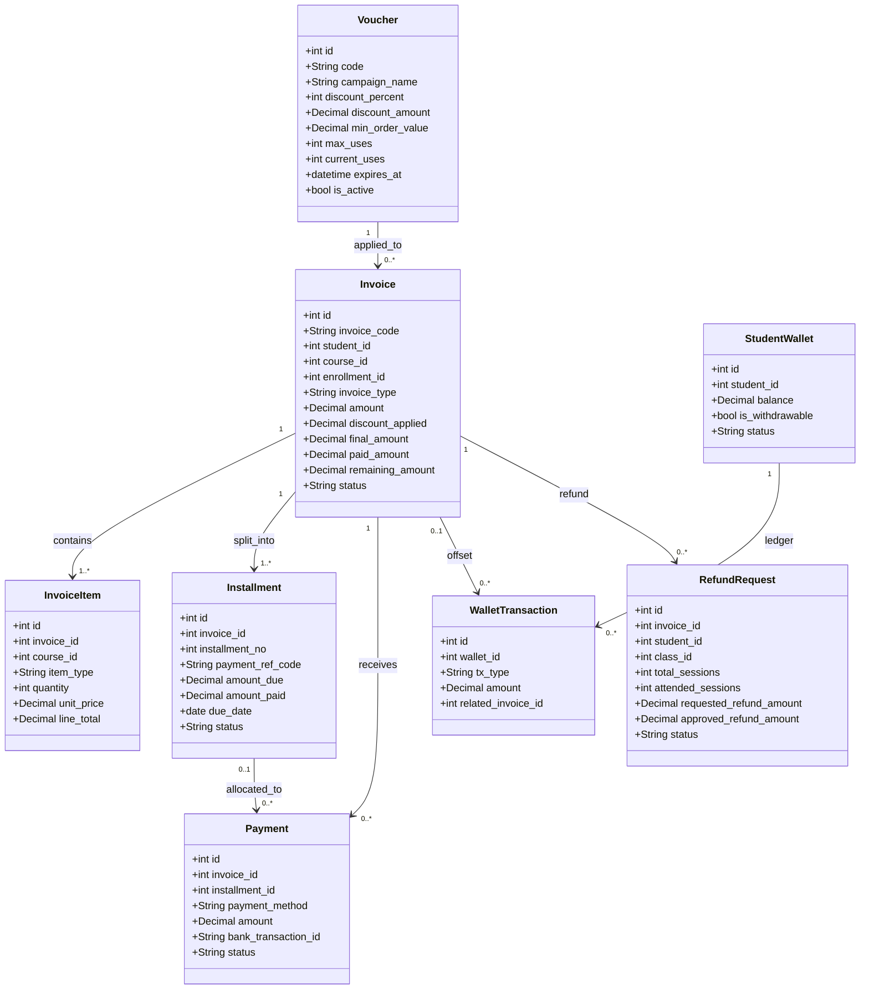

---

## 4. Biểu đồ Tuần tự (Sequence Diagrams)

### 4.1. Tạo hóa đơn từ biểu phí (MVP)

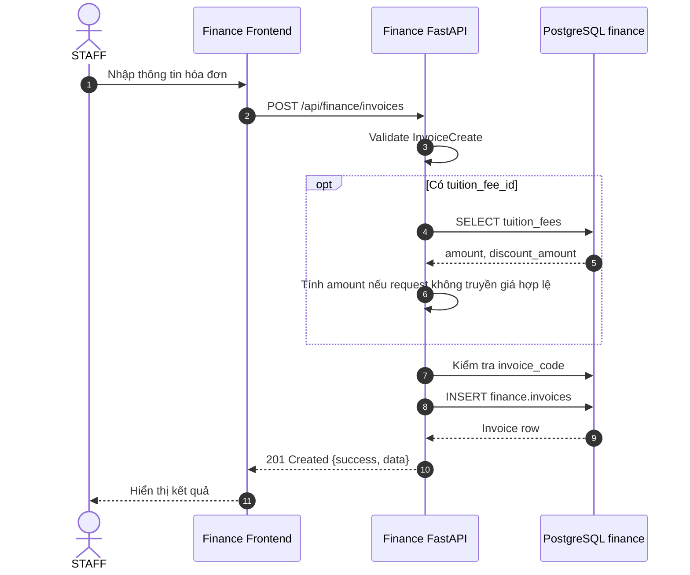

### 4.2. Ghi nhận thanh toán và cập nhật hóa đơn (MVP)

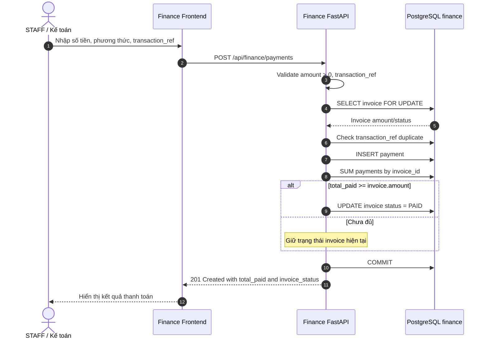

### 4.3. Gạch nợ VietQR

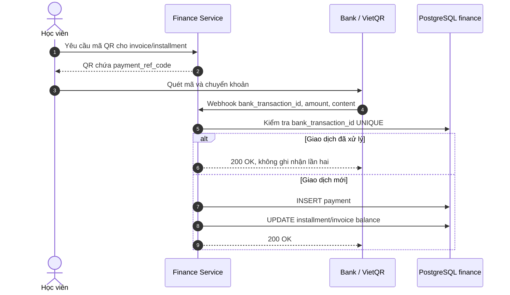

### 4.4. Quy trình phê duyệt hoàn tiền 3 cấp

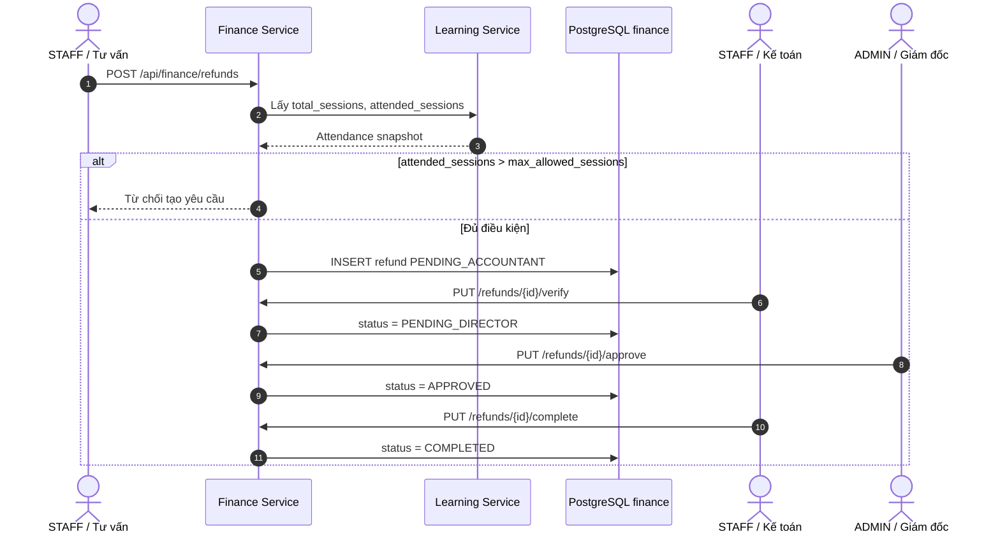

---

## 5. Biểu đồ Máy Trạng thái (State Machines)

### 5.1. Vòng đời Invoice

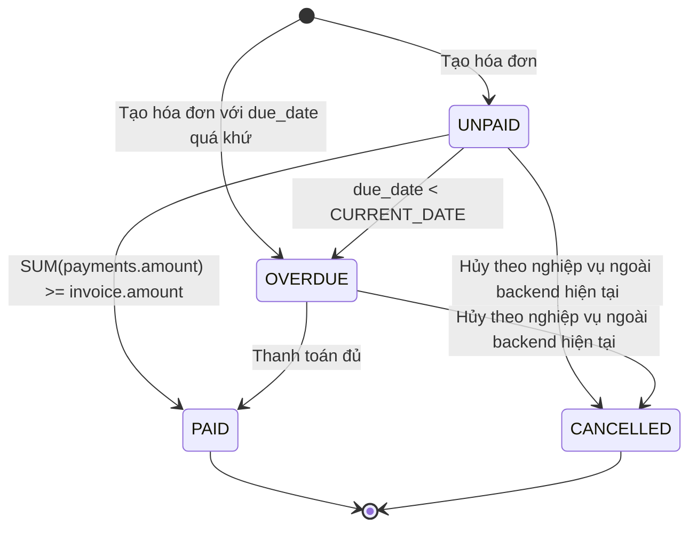

Backend hiện có logic đổi UNPAID thành OVERDUE và đổi trạng thái sang PAID khi thanh toán đủ. Route hủy hóa đơn chưa có trong file `main.py`.

### 5.2. Vòng đời Payment

Payment được ghi nhận bằng bản ghi giao dịch và thời điểm `paid_at`; vòng đời giao dịch được quản lý theo kết quả ghi nhận thanh toán.

### 5.3. Vòng đời Refund

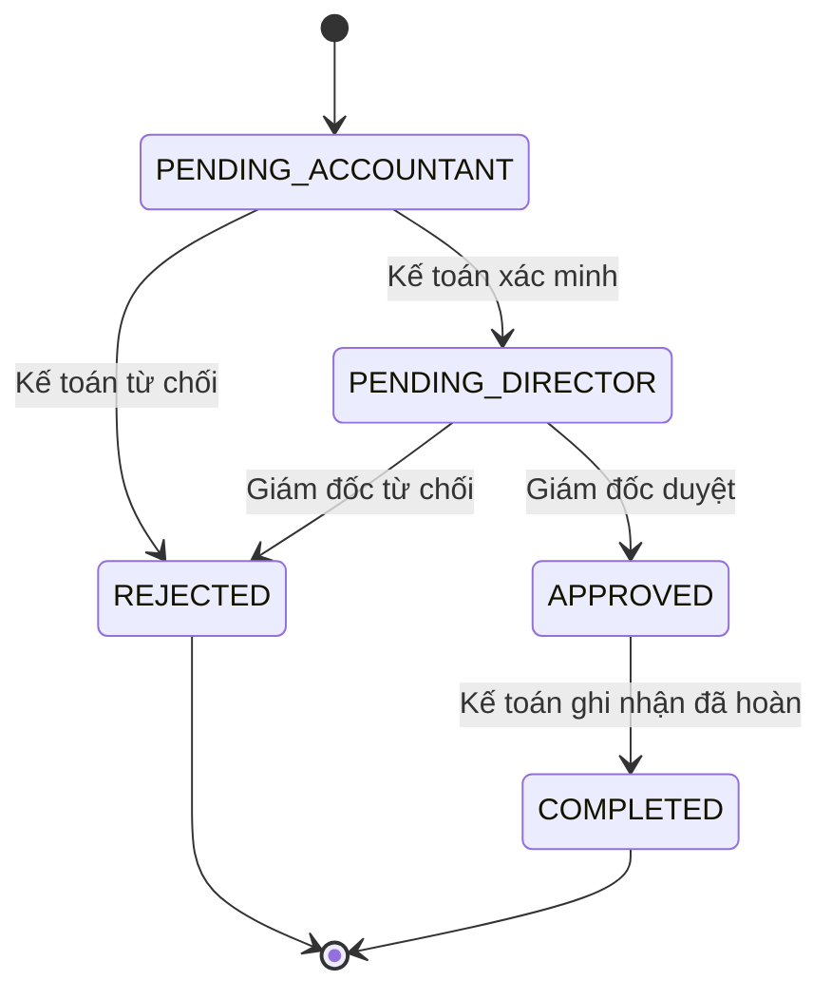

---

## 6. Biểu đồ Hoạt động (Activity Diagrams)

### 6.1. Kiểm tra và ghi nhận thanh toán

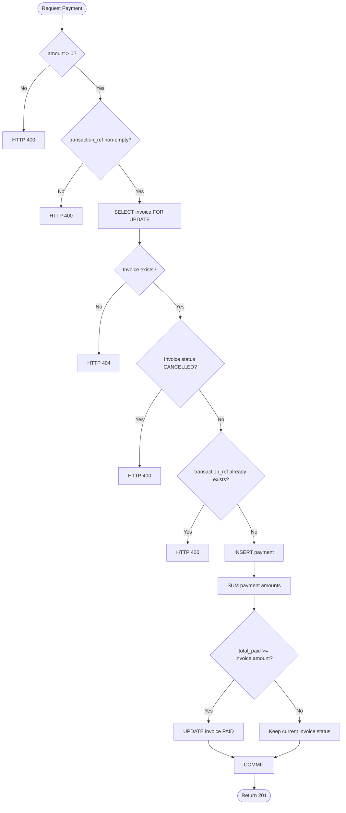

### 6.2. Tính số dư hóa đơn

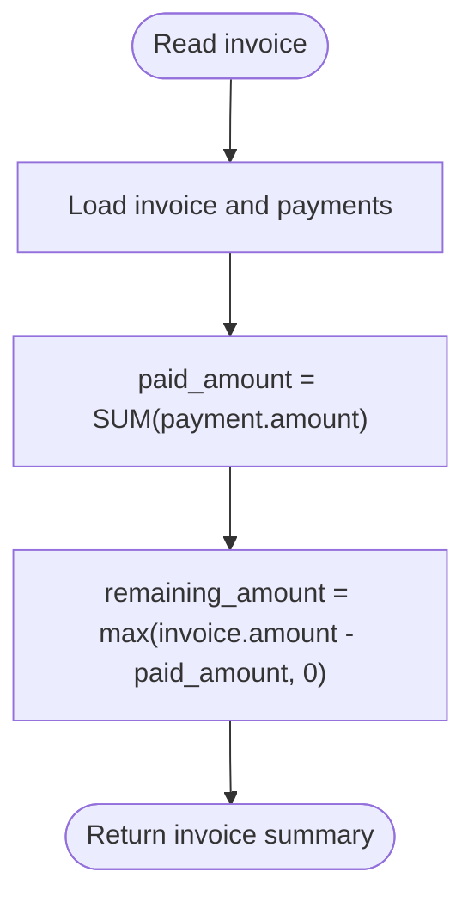

---

## 7. Ma trận Truy vết Yêu cầu

| Mã yêu cầu | Use Case | Entity/Data | Luồng UML |
|---|---|---|---|
| FIN-F01 | Quản lý biểu phí | TuitionFee | Use Case biểu phí; sequence cập nhật biểu phí |
| FIN-F02 | Kiểm tra Voucher | Voucher | Use Case Voucher và Domain Model |
| FIN-F03 | Tạo hóa đơn | Invoice | Sequence tạo hóa đơn |
| FIN-F04 | Tra cứu hóa đơn | Invoice, Payment | Use Case tra cứu; query invoice |
| FIN-F05 | Ghi nhận thanh toán | Payment | Sequence thanh toán; Activity thanh toán |
| FIN-F06 | VietQR webhook | Payment, Installment | Sequence VietQR |
| FIN-F07 | Ví bảo lưu | StudentWallet, WalletTransaction | Use Case ví và Domain Model |
| FIN-F08 | Hoàn phí | RefundRequest | Sequence refund và State machine refund |
| FIN-F09 | BI tài chính | BI Views | Use Case BI |

**Quy ước:** Các sơ đồ thể hiện các thực thể dữ liệu, tác nhân và luồng nghiệp vụ thuộc phạm vi Finance Service.
