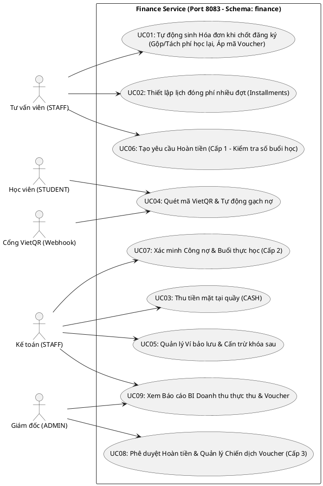
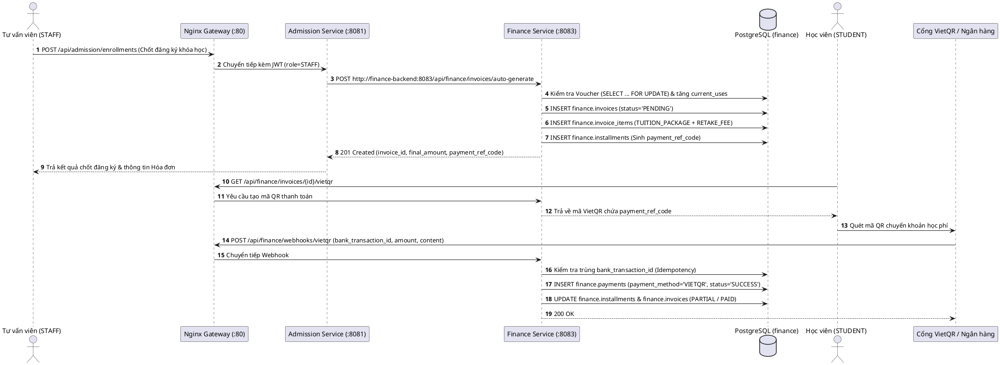
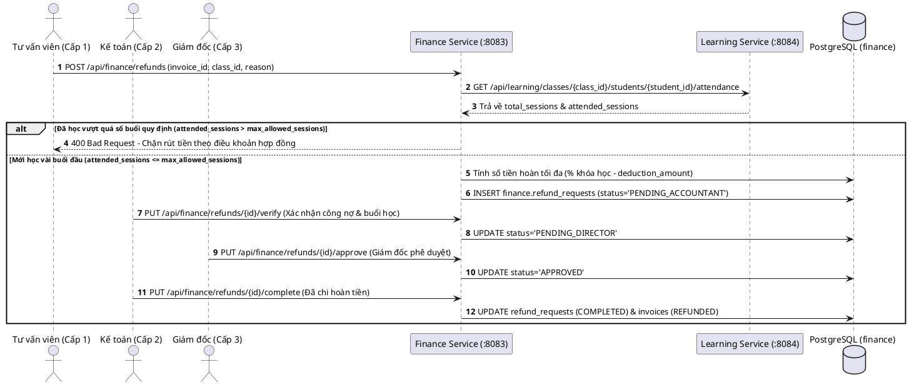
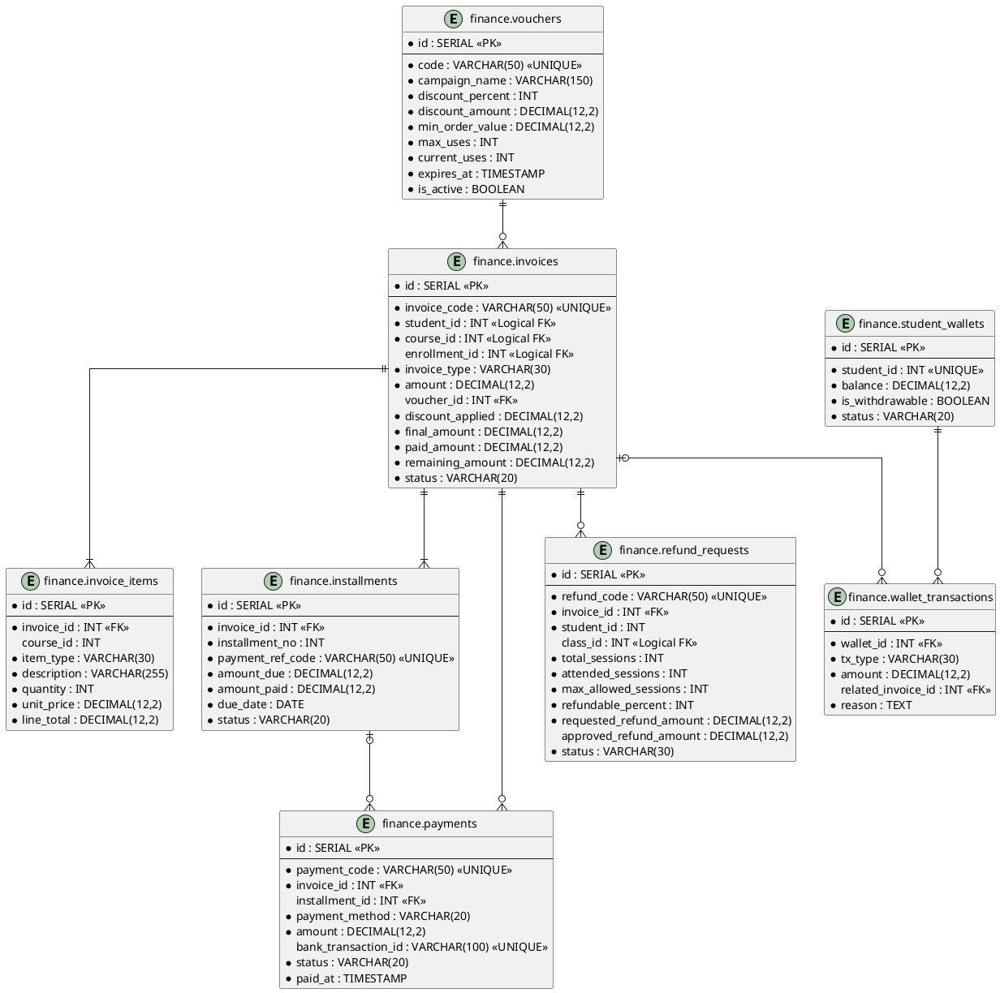

# TỔNG HỢP TÍNH NĂNG VÀ CƠ SỞ DỮ LIỆU PHÂN HỆ TÀI CHÍNH (FINANCE)

**Dự án:** Hệ thống Quản lý Trung tâm Anh ngữ  
**Phân hệ:** Finance Service (`finance-service`, port nội bộ `8084`)  
**Công nghệ trong mã nguồn hiện tại:** Python 3.11+, FastAPI, SQLAlchemy, PostgreSQL  
**Schema sở hữu:** `finance`  
**Phiên bản tài liệu:** 1.0 (Master BA/BI & Technical Summary – chuẩn hóa theo mẫu Admission)  
**Cơ sở biên soạn:** `Finance_Module.docx` do nhóm cung cấp; đối chiếu với `main` của repository `133mSS/english_center`.  
**Trạng thái:** Tài liệu tổng hợp thiết kế mục tiêu và hiện trạng repository; không phải xác nhận tất cả tính năng mục tiêu đã được triển khai.

> **Quy ước đọc tài liệu:** Nội dung được gắn nhãn **Thiết kế mục tiêu** là các yêu cầu trong Finance_Module.docx. Nội dung gắn nhãn **Hiện trạng GitHub** là những gì kiểm tra được trực tiếp trong `scripts/init-db.sql`, `services/finance/backend/main.py`, `docs/invariants.md`, `docs/architecture.md` và `docs/api-conventions.md` trên nhánh `main`. Hai lớp thông tin không được xem là tương đương.

## MỤC LỤC
1. [Tổng quan Phân hệ & Kiến trúc Tích hợp](#1-tổng-quan-phân-hệ--kiến-trúc-tích-hợp)
   - 1.1. Mục tiêu Nghiệp vụ
   - 1.2. Ranh giới Trách nhiệm & Ngoài phạm vi
   - 1.3. Kiến trúc và ranh giới dữ liệu
2. [Tác nhân Hệ thống & Phân quyền](#2-tác-nhân-hệ-thống--phân-quyền)
   - 2.1. Danh mục tác nhân
   - 2.2. Ma trận phân quyền theo thiết kế mục tiêu
3. [Quy trình Nghiệp vụ Cốt lõi](#3-quy-trình-nghiệp-vụ-cốt-lõi)
   - 3.1. Cấu hình học phí và Voucher
   - 3.2. Sinh hóa đơn và lịch thanh toán
   - 3.3. Thu tiền và đối soát VietQR
   - 3.4. Bảo lưu và hoàn tiền
4. [Danh mục Yêu cầu Chức năng (FR)](#4-danh-mục-yêu-cầu-chức-năng-fr)
5. [Mô hình Cơ sở Dữ liệu & Data Dictionary](#5-mô-hình-cơ-sở-dữ-liệu--data-dictionary)
   - 5.1. Ranh giới schema
   - 5.2. Danh mục 8 bảng thiết kế mục tiêu
   - 5.3. Data Dictionary
   - 5.4. Các BI Views
   - 5.5. DDL thiết kế mục tiêu
   - 5.6. Hiện trạng DDL trên GitHub
6. [Hợp đồng API](#6-hợp-đồng-api)
   - 6.1. API thiết kế mục tiêu
   - 6.2. API hiện có trong backend trên GitHub
7. [Business Intelligence & KPI](#7-business-intelligence--kpi)
8. [Quy tắc Bất biến & Chiến lược Kiểm thử](#8-quy-tắc-bất-biến--chiến-lược-kiểm-thử)
9. [Mô hình UML & Luồng Liên Service](#9-mô-hình-uml--luồng-liên-service)
10. [Rà soát Chênh lệch, Rủi ro và Kế hoạch Hoàn thiện](#10-rà-soát-chênh-lệch-rủi-ro-và-kế-hoạch-hoàn-thiện)
11. [Nguồn Đối chiếu](#11-nguồn-đối-chiếu)

---

## 1. Tổng quan Phân hệ & Kiến trúc Tích hợp

### 1.1. Mục tiêu Nghiệp vụ

**Finance Service** chịu trách nhiệm quản lý nghĩa vụ học phí và dòng tiền của học viên, từ cấu hình biểu phí, lập hóa đơn, thu tiền, theo dõi công nợ đến hoàn phí/bảo lưu và cung cấp số liệu BI.

Các mục tiêu nghiệp vụ trong **Finance_Module.docx** gồm:
- Quản lý học phí theo gói khóa học; phí kiểm tra đầu vào và giáo trình/tài liệu được gộp vào gói chuẩn theo chính sách.
- Hỗ trợ phụ phí học lại được gộp vào hóa đơn chính (`MIXED`) hoặc tách hóa đơn độc lập (`STANDALONE_RETAKE`).
- Quản lý Voucher theo phần trăm hoặc số tiền cố định, giới hạn lượt dùng, giá trị đơn tối thiểu và thời hạn.
- Tự động sinh hóa đơn khi Admission chốt đăng ký; hỗ trợ thanh toán một lần hoặc nhiều đợt.
- Thu tiền mặt và chuyển khoản qua VietQR; hỗ trợ webhook để tự động đối soát.
- Quản lý ví bảo lưu nội bộ, không cho rút tiền mặt tự do; số dư chỉ dùng cấn trừ học phí khóa tiếp theo.
- Quản lý quy trình hoàn tiền 3 cấp dựa trên số buổi học thực tế, điều khoản hoàn phí và khoản khấu trừ.
- Cung cấp BI theo dòng tiền thực thu (cash-basis), hiệu quả Voucher, hoàn phí và quỹ bảo lưu.

### 1.2. Ranh giới Trách nhiệm & Ngoài phạm vi

**Thuộc phạm vi Finance (theo thiết kế mục tiêu):**
- Biểu phí và chính sách giảm giá/Voucher.
- Hóa đơn, các khoản mục hóa đơn, lịch thanh toán nhiều đợt và công nợ.
- Ghi nhận thanh toán, đối soát ngân hàng/VietQR và chống ghi nhận giao dịch trùng.
- Ví bảo lưu, lịch sử biến động ví, yêu cầu và phê duyệt hoàn tiền.
- Báo cáo doanh thu thực thu, Voucher, hoàn phí và số dư bảo lưu.

**Ngoài phạm vi Finance:**
- Xét tuyển, tạo đơn đăng ký và quản lý trạng thái tuyển sinh: thuộc Admission.
- Quản lý hồ sơ cá nhân và thông tin liên hệ chuẩn của học viên: thuộc Student/Identity theo ranh giới hệ thống.
- Quản lý lịch học, điểm danh, buổi học và kết quả học tập: thuộc Student/Learning.
- Chi phí vận hành (OpEx), bảng lương nhân sự/giáo viên.
- Chuyển nhượng học phí giữa học viên; xử lý chênh lệch khi chuyển lớp/chuyển khóa chưa được mô tả trong phạm vi tài liệu Finance.

### 1.3. Kiến trúc và ranh giới dữ liệu

Trong kiến trúc repository, Finance sở hữu schema `finance` trong PostgreSQL dùng chung. Finance chạy ở **port nội bộ 8084**, thông qua Nginx API Gateway ở port 8080; Browser chỉ truy cập qua Gateway. Không sử dụng port 8083 cho Finance vì port 8083 được kiến trúc hiện tại dành cho Learning.

```text
Browser
   |
   v
Nginx API Gateway (:8080)
   |  /api/finance/*
   v
Finance Service (:8084)  ----> PostgreSQL / schema finance
   |
   +---- REST/API integration ---- Admission Service (:8081)
   +---- REST/API integration ---- Student/Learning Services (theo use case)
```

**Nguyên tắc dữ liệu:**
- `finance` là schema do Finance Service sở hữu.
- Các mã `student_id`, `course_id`, `enrollment_id`, `class_id` là định danh tham chiếu liên service. Không lưu bản sao tên/email hồ sơ nếu không cần thiết.
- Không tạo khóa ngoại vật lý chéo schema cho `student_id`, `course_id`, `enrollment_id`, `class_id`; các liên kết này được kiểm soát qua API và tầng ứng dụng.
- Khóa chính nội bộ dùng `SERIAL`/integer như DDL hiện có và thiết kế mục tiêu trong tài liệu.
- JSON API sử dụng `snake_case`; thời gian trao đổi nên tuân thủ ISO 8601 theo quy ước chung.

**Lưu ý về port:** Finance_Module.docx ghi port `8083`, đồng thời mô tả Learning là `8084`. Kiến trúc repository `docs/architecture.md` quy định ngược lại: Learning `8083`, Finance `8084`. Bản tổng hợp này dùng port `8084` theo kiến trúc repository hiện tại.

## 2. Tác nhân Hệ thống & Phân quyền

### 2.1. Danh mục tác nhân

| Tác nhân | Vai trò trong Finance |
|---|---|
| `STUDENT` | Xem hóa đơn, lịch thanh toán, tạo/lấy thông tin thanh toán, xem ví bảo lưu của chính mình theo chính sách truy cập. |
| `STAFF` – Tư vấn/Tuyển sinh | Khởi tạo yêu cầu hóa đơn thông qua luồng Admission; tiếp nhận thông tin thanh toán và tạo yêu cầu hoàn phí theo quy trình. |
| `STAFF` – Kế toán | Ghi nhận tiền mặt, đối soát khoản thu, xác minh yêu cầu hoàn tiền, thực hiện chi hoàn sau khi được duyệt. |
| `ADMIN` – Giám đốc | Phê duyệt cấp cuối đối với hoàn tiền; theo dõi các báo cáo quản trị. |
| `ADMISSION_SERVICE` | Dịch vụ ngoài gọi Finance để yêu cầu sinh hóa đơn khi đăng ký được chốt. |
| `LEARNING_SERVICE` | Dịch vụ nguồn cung cấp dữ liệu tổng số buổi và số buổi học viên tham gia để Finance xét điều kiện hoàn phí/bảo lưu. |
| `BANK / VIETQR_WEBHOOK` | Hệ thống bên ngoài gửi thông báo giao dịch chuyển khoản để Finance đối soát và ghi nhận thanh toán. |
| `SYSTEM` | Tác vụ tự động cập nhật trạng thái, tính công nợ và tổng hợp BI khi được triển khai. |

### 2.2. Ma trận phân quyền theo thiết kế mục tiêu

| Chức năng | STUDENT | STAFF | ADMIN | Admission Service | Webhook ngân hàng |
|---|:---:|:---:|:---:|:---:|:---:|
| Xem hóa đơn của bản thân | ✓ | ✓ (theo phạm vi nghiệp vụ) | ✓ | – | – |
| Quản lý Voucher | – | ✓ | ✓ | – | – |
| Kiểm tra Voucher khi đăng ký | ✓ | ✓ | ✓ | gọi nội bộ | – |
| Sinh hóa đơn sau chốt đăng ký | – | – | – | ✓ | – |
| Ghi nhận thanh toán tiền mặt | – | ✓ Kế toán | ✓ | – | – |
| Tạo mã VietQR/xem hướng dẫn thanh toán | ✓ | ✓ | ✓ | – | – |
| Gửi webhook giao dịch | – | – | – | – | ✓ |
| Quản lý ví bảo lưu | xem ví của mình | ✓ Kế toán | ✓ | – | – |
| Tạo yêu cầu hoàn phí | – | ✓ Tư vấn | theo phân công | – | – |
| Xác minh hoàn phí cấp 2 | – | ✓ Kế toán | theo phân công | – | – |
| Phê duyệt hoàn phí cấp 3 | – | – | ✓ Giám đốc | – | – |
| Xem BI tài chính | – | ✓ (được cấp quyền) | ✓ | – | – |

> Ma trận trên phản ánh quy trình nghiệp vụ trong Finance_Module.docx. Việc giới hạn dữ liệu theo `student_id`, phân tách vai trò STAFF Tư vấn/Kế toán và xác thực JWT cần được hiện thực ở backend; không suy ra rằng chỉ khai báo role trong bảng là đủ.

## 3. Quy trình Nghiệp vụ Cốt lõi

### 3.1. Cấu hình học phí và Voucher

1. Quản trị/Kế toán cấu hình mức học phí cho khóa học.
2. Voucher có thể giảm theo `discount_percent` hoặc `discount_amount`.
3. Khi áp dụng Voucher, hệ thống kiểm tra trạng thái hoạt động, thời hạn, giá trị đơn tối thiểu và hạn mức lượt dùng.
4. Việc tăng `current_uses` cần được thực hiện trong transaction có khóa dòng (`SELECT ... FOR UPDATE`) để tránh vượt `max_uses` khi có nhiều đăng ký đồng thời.
5. Thiết kế mục tiêu lưu Voucher được áp dụng vào hóa đơn thông qua `voucher_id` và `discount_applied`.

### 3.2. Sinh hóa đơn và lịch thanh toán

1. Admission chốt đơn đăng ký và gửi thông tin cần thiết sang Finance.
2. Finance xác định gói học phí, phí học lại và Voucher (nếu có).
3. Finance tạo `invoices`, các dòng `invoice_items` và các kỳ thanh toán `installments`.
4. Tổng các khoản `amount_due` của các kỳ phải bằng `final_amount`.
5. Trả về mã hóa đơn và mã tham chiếu thanh toán để Admission/Frontend hiển thị cho học viên.

### 3.3. Thu tiền và đối soát VietQR

- **CASH:** Kế toán ghi nhận giao dịch thu tại quầy, gắn hóa đơn và kỳ thanh toán liên quan.
- **VIETQR:** Finance sinh mã QR động có `payment_ref_code`; ngân hàng gửi webhook chứa mã giao dịch và nội dung chuyển khoản.
- Finance xác minh giao dịch, kiểm tra `bank_transaction_id` duy nhất, xác định đúng hóa đơn/kỳ thanh toán và ghi nhận `payments`.
- Giao dịch webhook đã xử lý trước đó không được ghi nhận lần hai; phản hồi webhook cần idempotent.
- Khi số tiền đã thanh toán đạt nghĩa vụ tương ứng, cập nhật trạng thái installment và invoice theo state machine được định nghĩa.

### 3.4. Bảo lưu và hoàn tiền

**Bảo lưu:**
1. Khi phát sinh quyết định bảo lưu theo chính sách, Finance ghi nhận khoản tiền vào `student_wallets`.
2. Mọi biến động được lưu thành giao dịch trong `wallet_transactions`.
3. `is_withdrawable` mặc định `FALSE`; số dư chỉ sử dụng để cấn trừ học phí khóa tiếp theo (`TUITION_OFFSET`), không rút tiền mặt tự do.

**Hoàn tiền 3 cấp:**
1. Tư vấn viên tạo yêu cầu và cung cấp `invoice_id`, `class_id`, lý do.
2. Finance gọi Learning để lấy `total_sessions` và `attended_sessions`.
3. Chỉ tiếp nhận yêu cầu nếu `attended_sessions <= max_allowed_sessions` (mặc định nêu trong tài liệu là 3 buổi).
4. Finance tính số tiền hoàn dự kiến theo `paid_amount_snapshot`, `refundable_percent` và `deduction_amount`.
5. Kế toán xác minh công nợ và dữ liệu buổi học: `PENDING_ACCOUNTANT` → `PENDING_DIRECTOR`.
6. Giám đốc phê duyệt: `PENDING_DIRECTOR` → `APPROVED`.
7. Kế toán ghi nhận đã chi hoàn: `APPROVED` → `COMPLETED`; hóa đơn được cập nhật trạng thái phù hợp.
8. Yêu cầu bị từ chối chuyển `REJECTED`; không được đi tiếp sang hoàn tất.

## 4. Danh mục Yêu cầu Chức năng (FR)

Finance_Module.docx định nghĩa 9 nhóm/chức năng cấp cao (FIN-F01 đến FIN-F09). Bảng dưới giữ nguyên mã nghiệp vụ, đồng thời diễn giải đầu vào/đầu ra và các rule chính.

| Mã | Tên chức năng | Tác nhân | Input / Output chính | Quy tắc nghiệp vụ | Tích hợp |
|---|---|---|---|---|---|
| **FIN-F01** | Quản lý chiến dịch Voucher | ADMIN, STAFF | Input: code, campaign_name, discount_percent/discount_amount, max_uses, min_order_value, expires_at. Output: cấu hình Voucher. | Không vượt giới hạn lượt dùng; kiểm tra thời hạn và điều kiện đơn hàng. | Admission/Finance |
| **FIN-F02** | Kiểm tra tính hợp lệ Voucher | STUDENT, STAFF, ADMIN | Input: code, order_amount. Output: kết quả hợp lệ và `discount_applied` dự kiến. | Voucher hoạt động, chưa hết hạn, còn lượt, đạt đơn tối thiểu. | Admission → Finance |
| **FIN-F03** | Tự động sinh hóa đơn | Internal/Admission, ADMIN, STAFF theo thiết kế | Input: student_id, course_id, enrollment_id, loại hóa đơn, phí và lịch thanh toán. Output: invoice, items, installments. | Dùng transaction; không sinh hóa đơn sai tổng tiền; hỗ trợ gộp/tách phí học lại. | Admission → Finance |
| **FIN-F04** | Tra cứu hóa đơn | STUDENT, STAFF, ADMIN | Input: invoice_id hoặc student_id. Output: chi tiết hóa đơn, khoản mục, kỳ thanh toán, lịch sử thu. | Học viên chỉ xem dữ liệu của chính mình. | Frontend |
| **FIN-F05** | Ghi nhận thu tiền mặt | STAFF – Kế toán, ADMIN | Input: invoice_id, installment_id, amount. Output: payment receipt và số tiền đã thu. | Amount dương; không thu vượt nghĩa vụ; cập nhật trạng thái đúng. | Nội bộ Finance |
| **FIN-F06** | VietQR và webhook đối soát | STUDENT, STAFF, Webhook | Input: invoice/installment ref; bank_transaction_id, amount, content. Output: QR/payment status. | Idempotency bằng mã giao dịch ngân hàng duy nhất; webhook không ghi nhận lặp. | Bank/VietQR |
| **FIN-F07** | Ví bảo lưu | STUDENT, STAFF, ADMIN | Input: student_id, số tiền bảo lưu/cấn trừ, lý do. Output: wallet balance và wallet transaction. | Không rút tự do; cấn trừ theo loại giao dịch cho phép; số dư không âm. | Student/Admission |
| **FIN-F08** | Yêu cầu và phê duyệt hoàn tiền | STAFF – Tư vấn/Kế toán, ADMIN – Giám đốc | Input: invoice_id, class_id, reason, attendance snapshot, thông tin nhận tiền. Output: refund request và trạng thái duyệt. | Điều kiện số buổi; tính hoàn sau khấu trừ; đủ 3 cấp; lưu người duyệt và thời điểm. | Learning |
| **FIN-F09** | Báo cáo BI tài chính | ADMIN, STAFF được cấp quyền | Input: khoảng thời gian, bộ lọc. Output: doanh thu thực thu, Voucher, hoàn phí, quỹ bảo lưu. | Cash-basis; loại WALLET_OFFSET khỏi dòng tiền mới; hoàn phí chỉ tính khi COMPLETED. | Finance DB / BI |

## 5. Mô hình Cơ sở Dữ liệu & Data Dictionary

### 5.1. Ranh giới schema

Finance sở hữu schema `finance`. Trong thiết kế mục tiêu của `Finance_Module.docx` có 8 bảng nghiệp vụ và 2 views BI. Đây là **mô hình đích của tài liệu thiết kế**, không phải cấu trúc đang có trên `main` (xem mục 5.6).

### 5.2. Danh mục 8 bảng thiết kế mục tiêu

| STT | Bảng | Vai trò | Khóa/liên kết chính |
|---:|---|---|---|
| 1 | `finance.vouchers` | Chiến dịch giảm giá và hạn mức sử dụng | `id` PK; `code` UNIQUE |
| 2 | `finance.invoices` | Hóa đơn học phí, giảm giá, trạng thái và số dư còn phải thu | `id` PK; `voucher_id` FK nội bộ; student/course/enrollment là logical references |
| 3 | `finance.invoice_items` | Các dòng chi tiết gói học phí/phí học lại | `id` PK; `invoice_id` FK |
| 4 | `finance.installments` | Lịch đóng học phí nhiều đợt/đặt cọc | `id` PK; `invoice_id` FK; `payment_ref_code` UNIQUE |
| 5 | `finance.payments` | Giao dịch CASH/VIETQR/WALLET_OFFSET | `id` PK; `invoice_id`, `installment_id` FK; `bank_transaction_id` UNIQUE |
| 6 | `finance.student_wallets` | Số dư bảo lưu theo học viên | `id` PK; `student_id` UNIQUE (logical reference) |
| 7 | `finance.wallet_transactions` | Sổ cái giao dịch tăng/giảm ví | `id` PK; `wallet_id` FK; `related_invoice_id` FK |
| 8 | `finance.refund_requests` | Yêu cầu hoàn phí và lịch sử phê duyệt 3 cấp | `id` PK; `invoice_id` FK; student/class là logical references |

### 5.3. Data Dictionary

#### 5.3.1. `finance.vouchers`

| Cột | Kiểu | Nullable | Mặc định | Ràng buộc / Diễn giải |
|---|---|:---:|---|---|
| `id` | SERIAL | NO | auto | PK |
| `code` | VARCHAR(50) | NO | – | UNIQUE; mã Voucher |
| `campaign_name` | VARCHAR(150) | NO | Chiến dịch ưu đãi học phí | Tên chiến dịch |
| `discount_percent` | INT | YES | 0 | 0–100; % giảm |
| `discount_amount` | DECIMAL(12,2) | YES | 0 | Số tiền giảm cố định, không âm |
| `min_order_value` | DECIMAL(12,2) | YES | 0 | Giá trị đơn tối thiểu |
| `max_discount_amount` | DECIMAL(12,2) | YES | NULL | Trần số tiền giảm |
| `max_uses` | INT | YES | 100 | > 0; giới hạn lượt dùng |
| `current_uses` | INT | YES | 0 | >= 0 và <= max_uses |
| `valid_from` | TIMESTAMP | YES | CURRENT_TIMESTAMP | Thời điểm bắt đầu hiệu lực |
| `expires_at` | TIMESTAMP | NO | – | Hạn kết thúc hiệu lực |
| `is_active` | BOOLEAN | YES | TRUE | Bật/tắt Voucher |
| `created_at` | TIMESTAMP | YES | CURRENT_TIMESTAMP | Thời điểm tạo |

#### 5.3.2. `finance.invoices`

| Cột | Kiểu | Nullable | Mặc định | Ràng buộc / Diễn giải |
|---|---|:---:|---|---|
| `id` | SERIAL | NO | auto | PK |
| `invoice_code` | VARCHAR(50) | NO | – | UNIQUE; mã hóa đơn |
| `student_id` | INT | NO | – | Logical reference đến học viên |
| `course_id` | INT | NO | – | Logical reference đến khóa học |
| `enrollment_id` | INT | YES | NULL | Logical reference đến đơn tuyển sinh |
| `invoice_type` | VARCHAR(30) | NO | COURSE_PACKAGE | COURSE_PACKAGE / STANDALONE_RETAKE / MIXED |
| `amount` | DECIMAL(12,2) | NO | – | >= 0; tổng giá trị trước giảm |
| `voucher_id` | INT | YES | NULL | FK đến `finance.vouchers(id)` |
| `discount_applied` | DECIMAL(12,2) | YES | 0 | >= 0; tiền giảm được áp dụng |
| `final_amount` | DECIMAL(12,2) | NO | – | >= 0; `amount - discount_applied` |
| `paid_amount` | DECIMAL(12,2) | NO | 0 | >= 0 và <= final_amount |
| `remaining_amount` | DECIMAL(12,2) | generated | computed | `final_amount - paid_amount`, STORED |
| `status` | VARCHAR(20) | NO | PENDING | PENDING / PARTIAL / PAID / CANCELLED / REFUNDED |
| `notes` | TEXT | YES | NULL | Ghi chú |
| `created_at` | TIMESTAMP | YES | CURRENT_TIMESTAMP | Thời điểm tạo |
| `paid_at` | TIMESTAMP | YES | NULL | Thời điểm thanh toán đủ |

#### 5.3.3. `finance.invoice_items`

| Cột | Kiểu | Nullable | Mặc định | Ràng buộc / Diễn giải |
|---|---|:---:|---|---|
| `id` | SERIAL | NO | auto | PK |
| `invoice_id` | INT | NO | – | FK đến `finance.invoices(id)` ON DELETE CASCADE |
| `course_id` | INT | YES | NULL | Mã khóa học (logical reference) |
| `item_type` | VARCHAR(30) | NO | – | TUITION_PACKAGE / RETAKE_FEE |
| `description` | VARCHAR(255) | NO | – | Mô tả khoản mục |
| `quantity` | INT | NO | 1 | > 0 |
| `unit_price` | DECIMAL(12,2) | NO | – | >= 0 |
| `line_total` | DECIMAL(12,2) | NO | – | `quantity * unit_price` |
| `created_at` | TIMESTAMP | YES | CURRENT_TIMESTAMP | Thời điểm tạo |

#### 5.3.4. `finance.installments`

| Cột | Kiểu | Nullable | Mặc định | Ràng buộc / Diễn giải |
|---|---|:---:|---|---|
| `id` | SERIAL | NO | auto | PK |
| `invoice_id` | INT | NO | – | FK đến `finance.invoices(id)` ON DELETE CASCADE |
| `installment_no` | INT | NO | – | >= 1; số thứ tự kỳ |
| `payment_ref_code` | VARCHAR(50) | NO | – | UNIQUE; mã tham chiếu thanh toán |
| `amount_due` | DECIMAL(12,2) | NO | – | > 0; số tiền kỳ phải đóng |
| `amount_paid` | DECIMAL(12,2) | NO | 0 | >= 0; đã đóng của kỳ |
| `due_date` | DATE | NO | – | Hạn thanh toán |
| `status` | VARCHAR(20) | NO | PENDING | PENDING / PARTIAL / PAID / OVERDUE / CANCELLED |
| `paid_at` | TIMESTAMP | YES | NULL | Thời điểm kỳ được thanh toán đủ |
| `created_at` | TIMESTAMP | YES | CURRENT_TIMESTAMP | Thời điểm tạo |
| UNIQUE | – | – | – | `(invoice_id, installment_no)` |

#### 5.3.5. `finance.payments`

| Cột | Kiểu | Nullable | Mặc định | Ràng buộc / Diễn giải |
|---|---|:---:|---|---|
| `id` | SERIAL | NO | auto | PK |
| `payment_code` | VARCHAR(50) | NO | – | UNIQUE; mã phiếu thu |
| `invoice_id` | INT | NO | – | FK đến `finance.invoices(id)` |
| `installment_id` | INT | YES | NULL | FK đến `finance.installments(id)` |
| `payment_method` | VARCHAR(20) | NO | – | CASH / VIETQR / WALLET_OFFSET |
| `amount` | DECIMAL(12,2) | NO | – | > 0 |
| `bank_transaction_id` | VARCHAR(100) | YES | NULL | UNIQUE; mã giao dịch ngân hàng |
| `qr_reference_code` | VARCHAR(50) | YES | NULL | Mã tham chiếu QR |
| `webhook_payload` | JSONB | YES | NULL | Payload webhook phục vụ đối soát/kiểm tra |
| `received_by_staff_id` | INT | YES | NULL | Người nhận tiền (logical reference) |
| `status` | VARCHAR(20) | NO | SUCCESS | PENDING / SUCCESS / FAILED |
| `paid_at` | TIMESTAMP | YES | CURRENT_TIMESTAMP | Thời điểm ghi nhận |

#### 5.3.6. `finance.student_wallets`

| Cột | Kiểu | Nullable | Mặc định | Ràng buộc / Diễn giải |
|---|---|:---:|---|---|
| `id` | SERIAL | NO | auto | PK |
| `student_id` | INT | NO | – | UNIQUE; logical reference đến học viên |
| `balance` | DECIMAL(12,2) | NO | 0 | >= 0; số dư bảo lưu |
| `is_withdrawable` | BOOLEAN | NO | FALSE | Khóa rút tiền tự do |
| `status` | VARCHAR(20) | NO | ACTIVE | ACTIVE / FROZEN |
| `updated_at` | TIMESTAMP | YES | CURRENT_TIMESTAMP | Thời điểm cập nhật |

#### 5.3.7. `finance.wallet_transactions`

| Cột | Kiểu | Nullable | Mặc định | Ràng buộc / Diễn giải |
|---|---|:---:|---|---|
| `id` | SERIAL | NO | auto | PK |
| `wallet_id` | INT | NO | – | FK đến `finance.student_wallets(id)` |
| `tx_type` | VARCHAR(30) | NO | – | RESERVATION_CREDIT / TUITION_OFFSET / ADJUSTMENT |
| `amount` | DECIMAL(12,2) | NO | – | > 0 |
| `related_invoice_id` | INT | YES | NULL | FK đến `finance.invoices(id)` |
| `reason` | TEXT | NO | – | Lý do biến động ví |
| `created_by_staff_id` | INT | YES | NULL | Người tạo giao dịch |
| `created_at` | TIMESTAMP | YES | CURRENT_TIMESTAMP | Thời điểm giao dịch |

#### 5.3.8. `finance.refund_requests`

| Cột | Kiểu | Nullable | Mặc định | Ràng buộc / Diễn giải |
|---|---|:---:|---|---|
| `id` | SERIAL | NO | auto | PK |
| `refund_code` | VARCHAR(50) | NO | – | UNIQUE; mã yêu cầu hoàn phí |
| `invoice_id` | INT | NO | – | FK đến `finance.invoices(id)` |
| `student_id` | INT | NO | – | Logical reference đến học viên |
| `class_id` | INT | YES | NULL | Logical reference đến lớp học |
| `total_sessions` | INT | NO | – | > 0; tổng số buổi của lớp |
| `attended_sessions` | INT | NO | – | >= 0; số buổi đã tham gia |
| `max_allowed_sessions` | INT | NO | 3 | Số buổi tối đa được xét hoàn |
| `paid_amount_snapshot` | DECIMAL(12,2) | NO | – | Số đã thanh toán tại thời điểm yêu cầu |
| `refundable_percent` | INT | NO | – | 0–100; tỷ lệ hoàn theo hợp đồng |
| `deduction_amount` | DECIMAL(12,2) | NO | 0 | Khoản khấu trừ |
| `requested_refund_amount` | DECIMAL(12,2) | NO | – | >= 0; số tiền đề nghị hoàn |
| `approved_refund_amount` | DECIMAL(12,2) | YES | NULL | >= 0; số tiền được duyệt |
| `reason` | TEXT | NO | – | Lý do yêu cầu |
| `bank_name` | VARCHAR(100) | YES | NULL | Ngân hàng nhận tiền |
| `bank_account_no` | VARCHAR(50) | YES | NULL | Số tài khoản nhận hoàn |
| `bank_account_holder` | VARCHAR(150) | YES | NULL | Chủ tài khoản nhận hoàn |
| `status` | VARCHAR(30) | NO | PENDING_ACCOUNTANT | PENDING_ACCOUNTANT / PENDING_DIRECTOR / APPROVED / REJECTED / COMPLETED |
| `requested_by_staff_id` | INT | NO | – | Người lập yêu cầu |
| `requested_at` | TIMESTAMP | YES | CURRENT_TIMESTAMP | Thời điểm lập |
| `verified_by_accountant_id` | INT | YES | NULL | Kế toán xác minh |
| `verified_at` | TIMESTAMP | YES | NULL | Thời điểm xác minh |
| `accountant_note` | TEXT | YES | NULL | Ghi chú kế toán |
| `approved_by_director_id` | INT | YES | NULL | Giám đốc phê duyệt |
| `approved_at` | TIMESTAMP | YES | NULL | Thời điểm duyệt |
| `director_note` | TEXT | YES | NULL | Ghi chú giám đốc |
| `completed_at` | TIMESTAMP | YES | NULL | Thời điểm hoàn tất chi trả |

### 5.4. Các BI Views

**`finance.vw_bi_cash_revenue_monthly`** – Tổng hợp theo tháng:
- `report_month`: tháng báo cáo.
- `cash_at_counter`: tổng thu tiền mặt thành công.
- `vietqr_transfer`: tổng thu VietQR thành công.
- `gross_cash_in`: tổng dòng tiền mới từ CASH và VIETQR.
- `refund_count`, `total_refunded`: số yêu cầu và số tiền hoàn đã hoàn tất.
- `net_cash_revenue`: `gross_cash_in - total_refunded`.
- `refund_rate_pct`: tỷ lệ tiền hoàn trên gross cash-in.

**`finance.vw_bi_voucher_campaigns`** – Hiệu quả Voucher:
- Thông tin Voucher, lượt dùng tối đa/hiện tại, `usage_rate_pct`.
- `total_invoices`, `total_discount_given`, `actual_cash_collected`.

> Các view trên được định nghĩa trong DDL mục tiêu của Finance_Module.docx. Chúng không xuất hiện trong `scripts/init-db.sql` hiện tại trên GitHub.

### 5.5. DDL thiết kế mục tiêu

Đoạn DDL sau được trích từ `Finance_Module.docx` (8 bảng và 2 views). Đây là DDL của thiết kế mục tiêu, **không phải** DDL đang có trên nhánh `main`.

```sql
-- ============================================================================
-- SCHEMA: finance (Chuẩn hóa theo scripts/init-db.sql của dự án english_center)
-- Primary Key / Logical Foreign Key: SERIAL / INTEGER
-- ============================================================================

CREATE SCHEMA IF NOT EXISTS finance;

-- 1. BẢNG CHIẾN DỊCH VOUCHER (Kế thừa init-db.sql & mở rộng)
CREATE TABLE IF NOT EXISTS finance.vouchers (
    id SERIAL PRIMARY KEY,
    code VARCHAR(50) UNIQUE NOT NULL,
    campaign_name VARCHAR(150) NOT NULL DEFAULT 'Chiến dịch ưu đãi học phí',
    discount_percent INT DEFAULT 0 CHECK (discount_percent >= 0 AND discount_percent <= 100),
    discount_amount DECIMAL(12, 2) DEFAULT 0 CHECK (discount_amount >= 0),
    min_order_value DECIMAL(12, 2) DEFAULT 0 CHECK (min_order_value >= 0),
    max_discount_amount DECIMAL(12, 2) DEFAULT NULL,
    max_uses INT DEFAULT 100 CHECK (max_uses > 0),
    current_uses INT DEFAULT 0 CHECK (current_uses >= 0),
    valid_from TIMESTAMP DEFAULT CURRENT_TIMESTAMP,
    expires_at TIMESTAMP NOT NULL,
    is_active BOOLEAN DEFAULT TRUE,
    created_at TIMESTAMP DEFAULT CURRENT_TIMESTAMP,
    CONSTRAINT chk_voucher_usage_limit CHECK (current_uses <= max_uses)
);

-- 2. BẢNG HÓA ĐƠN (Kế thừa init-db.sql & mở rộng trả góp, gộp/tách học lại)
CREATE TABLE IF NOT EXISTS finance.invoices (
    id SERIAL PRIMARY KEY,
    invoice_code VARCHAR(50) UNIQUE NOT NULL,
    student_id INT NOT NULL,
    course_id INT NOT NULL,
    enrollment_id INT,
    invoice_type VARCHAR(30) NOT NULL DEFAULT 'COURSE_PACKAGE'
        CHECK (invoice_type IN ('COURSE_PACKAGE', 'STANDALONE_RETAKE', 'MIXED')),
    amount DECIMAL(12, 2) NOT NULL CHECK (amount >= 0),
    voucher_id INT REFERENCES finance.vouchers(id),
    discount_applied DECIMAL(12, 2) DEFAULT 0 CHECK (discount_applied >= 0),
    final_amount DECIMAL(12, 2) NOT NULL CHECK (final_amount >= 0),
    paid_amount DECIMAL(12, 2) NOT NULL DEFAULT 0 CHECK (paid_amount >= 0),
    remaining_amount DECIMAL(12, 2) GENERATED ALWAYS AS (final_amount - paid_amount) STORED,
    status VARCHAR(20) NOT NULL DEFAULT 'PENDING'
        CHECK (status IN ('PENDING', 'PARTIAL', 'PAID', 'CANCELLED', 'REFUNDED')),
    notes TEXT,
    created_at TIMESTAMP DEFAULT CURRENT_TIMESTAMP,
    paid_at TIMESTAMP,
    CONSTRAINT chk_invoice_math CHECK (final_amount = amount - discount_applied),
    CONSTRAINT chk_invoice_paid_bound CHECK (paid_amount <= final_amount)
);

-- 3. BẢNG CHI TIẾT KHOẢN MỤC HÓA ĐƠN (Gói học phí trọn gói & Phí học lại)
CREATE TABLE IF NOT EXISTS finance.invoice_items (
    id SERIAL PRIMARY KEY,
    invoice_id INT NOT NULL REFERENCES finance.invoices(id) ON DELETE CASCADE,
    course_id INT,
    item_type VARCHAR(30) NOT NULL
        CHECK (item_type IN ('TUITION_PACKAGE', 'RETAKE_FEE')),
    description VARCHAR(255) NOT NULL,
    quantity INT NOT NULL DEFAULT 1 CHECK (quantity > 0),
    unit_price DECIMAL(12, 2) NOT NULL CHECK (unit_price >= 0),
    line_total DECIMAL(12, 2) NOT NULL CHECK (line_total >= 0),
    created_at TIMESTAMP DEFAULT CURRENT_TIMESTAMP,
    CONSTRAINT chk_line_total_math CHECK (line_total = quantity * unit_price)
);

-- 4. BẢNG LỊCH ĐÓNG HỌC PHÍ NHIỀU ĐỢT / ĐẶT CỌC (INSTALLMENTS)
CREATE TABLE IF NOT EXISTS finance.installments (
    id SERIAL PRIMARY KEY,
    invoice_id INT NOT NULL REFERENCES finance.invoices(id) ON DELETE CASCADE,
    installment_no INT NOT NULL CHECK (installment_no >= 1),
    payment_ref_code VARCHAR(50) UNIQUE NOT NULL,
    amount_due DECIMAL(12, 2) NOT NULL CHECK (amount_due > 0),
    amount_paid DECIMAL(12, 2) NOT NULL DEFAULT 0 CHECK (amount_paid >= 0),
    due_date DATE NOT NULL,
    status VARCHAR(20) NOT NULL DEFAULT 'PENDING'
        CHECK (status IN ('PENDING', 'PARTIAL', 'PAID', 'OVERDUE', 'CANCELLED')),
    paid_at TIMESTAMP,
    created_at TIMESTAMP DEFAULT CURRENT_TIMESTAMP,
    UNIQUE (invoice_id, installment_no)
);

-- 5. BẢNG GIAO DỊCH THU TIỀN & GẠCH NỢ TỰ ĐỘNG VIETQR (PAYMENTS)
CREATE TABLE IF NOT EXISTS finance.payments (
    id SERIAL PRIMARY KEY,
    payment_code VARCHAR(50) UNIQUE NOT NULL,
    invoice_id INT NOT NULL REFERENCES finance.invoices(id),
    installment_id INT REFERENCES finance.installments(id),
    payment_method VARCHAR(20) NOT NULL
        CHECK (payment_method IN ('CASH', 'VIETQR', 'WALLET_OFFSET')),
    amount DECIMAL(12, 2) NOT NULL CHECK (amount > 0),
    bank_transaction_id VARCHAR(100) UNIQUE,
    qr_reference_code VARCHAR(50),
    webhook_payload JSONB,
    received_by_staff_id INT,
    status VARCHAR(20) NOT NULL DEFAULT 'SUCCESS'
        CHECK (status IN ('PENDING', 'SUCCESS', 'FAILED')),
    paid_at TIMESTAMP DEFAULT CURRENT_TIMESTAMP
);

-- 6. BẢNG VÍ BẢO LƯU HỌC VIÊN (STUDENT WALLETS)
CREATE TABLE IF NOT EXISTS finance.student_wallets (
    id SERIAL PRIMARY KEY,
    student_id INT UNIQUE NOT NULL,
    balance DECIMAL(12, 2) NOT NULL DEFAULT 0 CHECK (balance >= 0),
    is_withdrawable BOOLEAN NOT NULL DEFAULT FALSE,
    status VARCHAR(20) NOT NULL DEFAULT 'ACTIVE'
        CHECK (status IN ('ACTIVE', 'FROZEN')),
    updated_at TIMESTAMP DEFAULT CURRENT_TIMESTAMP
);

-- 7. BẢNG LỊCH SỬ GIAO DỊCH VÍ BẢO LƯU (WALLET TRANSACTIONS)
CREATE TABLE IF NOT EXISTS finance.wallet_transactions (
    id SERIAL PRIMARY KEY,
    wallet_id INT NOT NULL REFERENCES finance.student_wallets(id),
    tx_type VARCHAR(30) NOT NULL
        CHECK (tx_type IN ('RESERVATION_CREDIT', 'TUITION_OFFSET', 'ADJUSTMENT')),
    amount DECIMAL(12, 2) NOT NULL CHECK (amount > 0),
    related_invoice_id INT REFERENCES finance.invoices(id),
    reason TEXT NOT NULL,
    created_by_staff_id INT,
    created_at TIMESTAMP DEFAULT CURRENT_TIMESTAMP
);

-- 8. BẢNG YÊU CẦU & PHÊ DUYỆT HOÀN TIỀN 3 CẤP (REFUND REQUESTS)
CREATE TABLE IF NOT EXISTS finance.refund_requests (
    id SERIAL PRIMARY KEY,
    refund_code VARCHAR(50) UNIQUE NOT NULL,
    invoice_id INT NOT NULL REFERENCES finance.invoices(id),
    student_id INT NOT NULL,
    class_id INT,
    total_sessions INT NOT NULL CHECK (total_sessions > 0),
    attended_sessions INT NOT NULL CHECK (attended_sessions >= 0),
    max_allowed_sessions INT NOT NULL DEFAULT 3,
    paid_amount_snapshot DECIMAL(12, 2) NOT NULL,
    refundable_percent INT NOT NULL CHECK (refundable_percent BETWEEN 0 AND 100),
    deduction_amount DECIMAL(12, 2) NOT NULL DEFAULT 0,
    requested_refund_amount DECIMAL(12, 2) NOT NULL CHECK (requested_refund_amount >= 0),
    approved_refund_amount DECIMAL(12, 2) CHECK (approved_refund_amount >= 0),
    reason TEXT NOT NULL,
    bank_name VARCHAR(100),
    bank_account_no VARCHAR(50),
    bank_account_holder VARCHAR(150),
    status VARCHAR(30) NOT NULL DEFAULT 'PENDING_ACCOUNTANT'
        CHECK (status IN (
            'PENDING_ACCOUNTANT',
            'PENDING_DIRECTOR',
            'APPROVED',
            'REJECTED',
            'COMPLETED'
        )),
    requested_by_staff_id INT NOT NULL,
    requested_at TIMESTAMP DEFAULT CURRENT_TIMESTAMP,
    verified_by_accountant_id INT,
    verified_at TIMESTAMP,
    accountant_note TEXT,
    approved_by_director_id INT,
    approved_at TIMESTAMP,
    director_note TEXT,
    completed_at TIMESTAMP,
    CONSTRAINT chk_valid_early_withdrawal CHECK (attended_sessions <= max_allowed_sessions)
);

-- VIEW 1: Báo cáo Doanh thu Thực thu (Cash-basis) và Hoàn phí theo Tháng
CREATE OR REPLACE VIEW finance.vw_bi_cash_revenue_monthly AS
WITH cash_in AS (
    SELECT 
        DATE_TRUNC('month', paid_at) AS report_month,
        SUM(CASE WHEN payment_method = 'CASH' THEN amount ELSE 0 END) AS cash_at_counter,
        SUM(CASE WHEN payment_method = 'VIETQR' THEN amount ELSE 0 END) AS vietqr_transfer,
        SUM(CASE WHEN payment_method IN ('CASH', 'VIETQR') THEN amount ELSE 0 END) AS gross_cash_in
    FROM finance.payments
    WHERE status = 'SUCCESS'
    GROUP BY DATE_TRUNC('month', paid_at)
),
cash_refund AS (
    SELECT 
        DATE_TRUNC('month', completed_at) AS report_month,
        COUNT(id) AS refund_count,
        SUM(approved_refund_amount) AS total_refunded
    FROM finance.refund_requests
    WHERE status = 'COMPLETED'
    GROUP BY DATE_TRUNC('month', completed_at)
)
SELECT 
    COALESCE(ci.report_month, cr.report_month) AS report_month,
    COALESCE(ci.cash_at_counter, 0) AS cash_at_counter,
    COALESCE(ci.vietqr_transfer, 0) AS vietqr_transfer,
    COALESCE(ci.gross_cash_in, 0) AS gross_cash_in,
    COALESCE(cr.refund_count, 0) AS refund_count,
    COALESCE(cr.total_refunded, 0) AS total_refunded,
    (COALESCE(ci.gross_cash_in, 0) - COALESCE(cr.total_refunded, 0)) AS net_cash_revenue,
    CASE 
        WHEN COALESCE(ci.gross_cash_in, 0) > 0 
        THEN ROUND((COALESCE(cr.total_refunded, 0) / ci.gross_cash_in) * 100, 2)
        ELSE 0 
    END AS refund_rate_pct
FROM cash_in ci
FULL OUTER JOIN cash_refund cr ON ci.report_month = cr.report_month
ORDER BY report_month DESC;

-- VIEW 2: Báo cáo Hiệu quả Chiến dịch Voucher
CREATE OR REPLACE VIEW finance.vw_bi_voucher_campaigns AS
SELECT 
    v.id AS voucher_id,
    v.code,
    v.campaign_name,
    v.discount_percent,
    v.discount_amount,
    v.max_uses,
    v.current_uses,
    ROUND((v.current_uses::DECIMAL / v.max_uses) * 100, 2) AS usage_rate_pct,
    COUNT(i.id) AS total_invoices,
    COALESCE(SUM(i.discount_applied), 0) AS total_discount_given,
    COALESCE(SUM(i.paid_amount), 0) AS actual_cash_collected
FROM finance.vouchers v
LEFT JOIN finance.invoices i ON v.id = i.voucher_id AND i.status != 'CANCELLED'
GROUP BY v.id;
```

### 5.6. Hiện trạng DDL trên GitHub

Trong `scripts/init-db.sql` trên nhánh `main`, schema Finance hiện có 3 bảng: `tuition_fees`, `invoices`, `payments`. DDL hiện trạng rút gọn như sau:

```sql
CREATE SCHEMA IF NOT EXISTS finance;

CREATE TABLE IF NOT EXISTS finance.tuition_fees (
    id SERIAL PRIMARY KEY,
    course_id INTEGER NOT NULL UNIQUE,
    amount NUMERIC(12, 2) NOT NULL CHECK (amount > 0),
    currency VARCHAR(10) NOT NULL DEFAULT 'VND',
    discount_code VARCHAR(50),
    discount_amount NUMERIC(12, 2) NOT NULL DEFAULT 0 CHECK (discount_amount >= 0),
    note TEXT,
    created_at TIMESTAMPTZ NOT NULL DEFAULT NOW()
);

CREATE TABLE IF NOT EXISTS finance.invoices (
    id SERIAL PRIMARY KEY,
    invoice_code VARCHAR(50) NOT NULL UNIQUE,
    student_id INTEGER NOT NULL,
    enrollment_id INTEGER,
    tuition_fee_id INTEGER REFERENCES finance.tuition_fees(id) ON DELETE SET NULL,
    amount NUMERIC(12, 2) NOT NULL CHECK (amount > 0),
    status VARCHAR(20) NOT NULL DEFAULT 'UNPAID'
        CHECK (status IN ('UNPAID', 'PAID', 'CANCELLED', 'OVERDUE')),
    due_date DATE NOT NULL,
    created_at TIMESTAMPTZ NOT NULL DEFAULT NOW()
);

CREATE TABLE IF NOT EXISTS finance.payments (
    id SERIAL PRIMARY KEY,
    invoice_id INTEGER NOT NULL REFERENCES finance.invoices(id) ON DELETE CASCADE,
    amount NUMERIC(12, 2) NOT NULL CHECK (amount > 0),
    payment_method VARCHAR(30) NOT NULL
        CHECK (payment_method IN ('CASH', 'BANK_TRANSFER')),
    transaction_ref VARCHAR(100) NOT NULL UNIQUE,
    paid_at TIMESTAMPTZ NOT NULL DEFAULT NOW()
);
```

**So sánh hai mô hình:**

| Thành phần | Thiết kế mục tiêu trong Finance_Module.docx | Hiện trạng `main` |
|---|---|---|
| Biểu phí | Voucher Campaign, discount theo %/amount | `tuition_fees` theo `course_id` duy nhất, `discount_code`, `discount_amount` |
| Hóa đơn | `amount`, `discount_applied`, `final_amount`, `paid_amount`, `remaining_amount`, `invoice_type`, `voucher_id` | `amount`, `status`, `due_date`, `tuition_fee_id` |
| Chi tiết hóa đơn | `invoice_items` | Chưa có |
| Trả góp | `installments` | Chưa có |
| Thanh toán | CASH/VIETQR/WALLET_OFFSET, bank transaction, webhook payload | CASH/BANK_TRANSFER, `transaction_ref` |
| Ví bảo lưu | `student_wallets`, `wallet_transactions` | Chưa có |
| Hoàn tiền | `refund_requests`, duyệt 3 cấp | Chưa có |
| BI | 2 views báo cáo | Chưa có Finance views tương ứng trong init-db.sql |

Không được chạy DDL thiết kế mục tiêu trực tiếp trên môi trường có dữ liệu hiện tại như một lần init mới. Cần chuẩn bị migration có kiểm soát, xác định mapping dữ liệu cũ, backup và kiểm thử rollback.

## 6. Hợp đồng API

### 6.1. API thiết kế mục tiêu

| Mã | Method | Endpoint | Quyền theo tài liệu | Mô tả |
|---|---|---|---|---|
| FIN-F01 | POST / GET | `/api/finance/vouchers` | ADMIN, STAFF | Tạo/xem chiến dịch Voucher. |
| FIN-F02 | POST | `/api/finance/vouchers/validate` | ADMIN, STAFF, STUDENT | Kiểm tra Voucher và tính mức giảm dự kiến. |
| FIN-F03 | POST | `/api/finance/invoices/auto-generate` | Internal/ADMIN/STAFF | Sinh invoice, items và installments khi Admission chốt đăng ký. |
| FIN-F04 | GET | `/api/finance/invoices`, `/api/finance/invoices/{id}` | ADMIN, STAFF, STUDENT | Tra cứu hóa đơn. |
| FIN-F05 | POST | `/api/finance/payments/cash` | ADMIN, STAFF | Ghi nhận tiền mặt. |
| FIN-F06 | GET / POST | `/api/finance/invoices/{id}/vietqr`, `/api/finance/webhooks/vietqr` | STUDENT/STAFF; Webhook | Sinh QR và nhận callback ngân hàng. |
| FIN-F07 | GET / POST | `/api/finance/wallets/{student_id}`, `/api/finance/wallets/{student_id}/reserve` | ADMIN, STAFF, STUDENT | Xem ví và ghi nhận bảo lưu/cấn trừ. |
| FIN-F08 | POST / PUT | `/api/finance/refunds`, `/api/finance/refunds/{id}/verify`, `/approve`, `/complete` | STAFF, ADMIN theo cấp duyệt | Quy trình hoàn phí 3 cấp. |
| FIN-F09 | GET | `/api/finance/bi/cash-revenue`, `/voucher-campaigns`, `/refund-summary` | ADMIN, STAFF | API dữ liệu BI. |

> Endpoint, role và payload ở mục này là **đặc tả mục tiêu** của Finance_Module.docx. Cần hoàn thiện API contract chi tiết (request/response schema, error codes, pagination, idempotency key, auth scopes) trước khi triển khai.

### 6.2. API hiện có trong backend trên GitHub

Trong `services/finance/backend/main.py` hiện kiểm tra được các endpoint:

| Method | Endpoint | Hiện trạng xử lý |
|---|---|---|
| GET | `/api/finance/health` | Health check, trả service/version/framework. |
| GET | `/api/finance/tuition-fees` | Liệt kê biểu phí, có filter `course_id`. |
| POST | `/api/finance/tuition-fees` | Tạo/cập nhật biểu phí theo `course_id`, có `amount`, `currency`, `discount_code`, `discount_amount`, `note`. |
| GET | `/api/finance/invoices` | Liệt kê hóa đơn, có filter `student_id`; tính tổng thanh toán và remaining amount từ payments; cập nhật UNPAID quá hạn thành OVERDUE. |
| POST | `/api/finance/invoices` | Tạo hóa đơn; có thể lấy giá từ `tuition_fee_id`; sinh `INV-...` nếu chưa truyền mã. |
| GET | `/api/finance/payments` | Liệt kê thanh toán, có filter `invoice_id`. |
| POST | `/api/finance/payments` | Ghi nhận thanh toán; kiểm tra amount dương, transaction_ref không rỗng/trùng, khóa hóa đơn `FOR UPDATE`, cập nhật invoice sang PAID khi tổng thu >= amount. |

**Contract hiện tại từ mã nguồn:**
- Pydantic model: `TuitionFeeCreate`, `InvoiceCreate`, `PaymentCreate`.
- `payment_method` hiện chỉ nhận `CASH` hoặc `BANK_TRANSFER`.
- Thanh toán dùng `transaction_ref` UNIQUE để chống trùng.
- Hóa đơn hiện dùng trạng thái `UNPAID`, `PAID`, `CANCELLED`, `OVERDUE`.
- Backend sử dụng `search_path=finance,public`; thông tin DB lấy qua biến môi trường `DB_USER`, `DB_PASSWORD`, `DB_HOST`, `DB_PORT`, `DB_NAME`.
- Startup có đoạn migration hỗ trợ thêm `tuition_fee_id` và unique constraint cho `payments.transaction_ref`.

## 7. Business Intelligence & KPI

| Mã KPI | Tên chỉ số | Công thức/định nghĩa | Ý nghĩa quản trị |
|---|---|---|---|
| BI-FIN-01 | Gross Cash-in | Tổng `payments.amount` với `status='SUCCESS'` và `payment_method IN ('CASH','VIETQR')` | Dòng tiền mới thu được; không tính WALLET_OFFSET. |
| BI-FIN-02 | Net Cash Revenue | `Gross Cash-in - SUM(approved_refund_amount)` với refund `status='COMPLETED'` | Doanh thu thực thu sau hoàn phí. |
| BI-FIN-03 | Outstanding AR | Tổng `remaining_amount` của hóa đơn PENDING/PARTIAL theo thiết kế mục tiêu | Tổng nghĩa vụ học phí chưa thu. |
| BI-FIN-04 | Overdue AR | Phần công nợ có `due_date < CURRENT_DATE` tại installments | Theo dõi nợ quá hạn và nhắc thu. |
| BI-FIN-05 | Voucher Usage Rate | `(current_uses / max_uses) * 100%` | Mức độ khai thác chương trình ưu đãi. |
| BI-FIN-06 | Total Discount Given | `SUM(discount_applied)` trên hóa đơn áp dụng Voucher | Chi phí giảm giá đã cấp. |
| BI-FIN-07 | Refund Rate | `(Tổng tiền hoàn / Gross Cash-in) * 100%` | Theo dõi tỷ lệ hoàn phí. |
| BI-FIN-08 | Wallet Balance | `SUM(student_wallets.balance)` | Tổng quỹ bảo lưu đang giữ. |

**Lưu ý:** KPI trên được định nghĩa theo thiết kế mục tiêu. Do schema và backend hiện tại chưa có refund, wallet, installment, Voucher campaign và views tương ứng, các KPI này chưa thể xác nhận đang được cung cấp từ repository `main`.

## 8. Quy tắc Bất biến & Chiến lược Kiểm thử

### 8.1. Invariants trong Finance_Module.docx (thiết kế mục tiêu)

| Mã | Quy tắc | Điều kiện kiểm soát |
|---|---|---|
| INV-FIN-01 | Bất biến hóa đơn đã thanh toán | Hóa đơn PAID/REFUNDED không được xóa hoặc sửa trực tiếp các cột tiền tệ. |
| INV-FIN-02 | Đẳng thức hóa đơn và trả góp | `final_amount = amount - discount_applied`; `0 <= paid_amount <= final_amount`; tổng `amount_due` installments bằng `final_amount`. |
| INV-FIN-03 | Cô lập schema | Finance chỉ truy cập schema `finance`; ID từ service khác là logical reference, không JOIN/physical FK chéo schema. |
| INV-FIN-04 | Chống race condition Voucher | Kiểm tra active, expires_at, max_uses trong row lock trước khi tăng current_uses. |
| INV-FIN-05 | Idempotency VietQR | `bank_transaction_id` UNIQUE; webhook lặp không tạo phiếu thu thứ hai. |
| INV-FIN-06 | Khóa rút tiền ví | `is_withdrawable = FALSE`; số dư giảm qua TUITION_OFFSET. |
| INV-FIN-07 | Chặn hoàn phí theo số buổi | Chỉ tạo yêu cầu khi `attended_sessions <= max_allowed_sessions`; duyệt đủ các trạng thái. |

### 8.2. Invariants được ghi nhận trong repository `docs/invariants.md`

| Mã | Quy tắc repository | Mức độ | Test file | Trạng thái ghi trong tài liệu |
|---|---|---|---|---|
| INV-FIN-01 | Số tiền thanh toán và hóa đơn phải > 0 | P0 | `test_finance_invariants.py` | VERIFIED |
| INV-FIN-02 | `transaction_ref` không được ghi nhận lần thứ hai | P0 | `test_finance_invariants.py` | VERIFIED |
| INV-FIN-03 | Chỉ chuyển PAID khi tổng payment hợp lệ >= invoice.amount | P0 | `test_finance_invariants.py` | VERIFIED |

**Lưu ý mã:** Các mã INV-FIN trong `docs/invariants.md` hiện mang ý nghĩa khác với mã INV-FIN trong Finance_Module.docx. Để tránh trùng mã gây hiểu sai, cần thống nhất ID mới cho bộ invariant thiết kế mục tiêu (ví dụ `FIN-DESIGN-INV-01...`) hoặc cập nhật một nguồn chuẩn duy nhất sau khi nhóm phê duyệt. Không đổi test assertion để làm khớp tài liệu.

### 8.3. Chiến lược kiểm thử đề xuất theo nhóm rule

- **Unit tests:** tính giảm giá, tính final_amount, phân bổ installments, tính phí hoàn và công nợ.
- **Integration tests:** tạo invoice → ghi payment → kiểm tra trạng thái invoice; webhook idempotency; liên kết FK nội bộ.
- **Concurrency tests:** nhiều request cùng sử dụng một Voucher hoặc thanh toán cùng invoice; xác nhận transaction/row lock ngăn cập nhật sai.
- **Authorization tests:** học viên A không truy cập hóa đơn/ví của học viên B; STAFF Tư vấn không tự phê duyệt cấp Giám đốc.
- **Migration tests:** nâng từ schema MVP hiện tại sang schema mục tiêu; bảo toàn invoice/payment cũ và rollback được.

## 9. Mô hình UML & Luồng Liên Service

### 9.1. Use Case tổng thể



### 9.2. Sinh hóa đơn và đối soát VietQR



### 9.3. Quy trình phê duyệt hoàn tiền 3 cấp



### 9.4. ERD thiết kế mục tiêu



### 9.5. Mermaid ERD rút gọn để hiển thị trực tiếp trên GitHub

```mermaid
erDiagram
    VOUCHERS ||--o{ INVOICES : applies_to
    INVOICES ||--|{ INVOICE_ITEMS : contains
    INVOICES ||--|{ INSTALLMENTS : split_into
    INVOICES ||--o{ PAYMENTS : receives
    INSTALLMENTS o|--o{ PAYMENTS : allocated_to
    STUDENT_WALLETS ||--o{ WALLET_TRANSACTIONS : records
    INVOICES o|--o{ WALLET_TRANSACTIONS : offsets
    INVOICES ||--o{ REFUND_REQUESTS : may_have

    VOUCHERS {
      int id PK
      string code UK
      int max_uses
      int current_uses
      timestamp expires_at
    }
    INVOICES {
      int id PK
      string invoice_code UK
      int student_id
      int course_id
      int enrollment_id
      decimal amount
      decimal discount_applied
      decimal final_amount
      decimal paid_amount
      string status
    }
    INVOICE_ITEMS {
      int id PK
      int invoice_id FK
      string item_type
      decimal line_total
    }
    INSTALLMENTS {
      int id PK
      int invoice_id FK
      string payment_ref_code UK
      decimal amount_due
      decimal amount_paid
      date due_date
      string status
    }
    PAYMENTS {
      int id PK
      int invoice_id FK
      int installment_id FK
      string payment_method
      decimal amount
      string bank_transaction_id UK
      string status
    }
    STUDENT_WALLETS {
      int id PK
      int student_id UK
      decimal balance
      boolean is_withdrawable
    }
    WALLET_TRANSACTIONS {
      int id PK
      int wallet_id FK
      int related_invoice_id FK
      string tx_type
      decimal amount
    }
    REFUND_REQUESTS {
      int id PK
      int invoice_id FK
      int student_id
      int class_id
      int attended_sessions
      string status
    }
```



## 10. Rà soát Chênh lệch, Rủi ro và Kế hoạch Hoàn thiện

### 10.1. Các chênh lệch cần xử lý trước khi xem Finance là hoàn chỉnh

| # | Vấn đề | Bằng chứng trong nguồn đối chiếu | Hành động cần thiết |
|---:|---|---|---|
| 1 | Port Finance không thống nhất | Word ghi 8083; `docs/architecture.md` ghi Finance 8084, Learning 8083. | Chuẩn hóa tài liệu, Docker Compose, Gateway và service config về 8084. |
| 2 | DDL Word không khớp DDL hiện có | Word mô tả 8 bảng + 2 views; `scripts/init-db.sql` chỉ có `tuition_fees`, `invoices`, `payments`. | Viết migration từ MVP lên thiết kế mục tiêu, không thay thế dữ liệu tùy tiện. |
| 3 | Backend MVP không có phần lớn endpoint mục tiêu | `main.py` có tuition-fees, invoices, payments; chưa thấy routes Voucher campaigns, installments, VietQR webhook, wallet, refunds, BI. | Lập backlog triển khai theo từng FIN-Fxx; bổ sung API contract và tests. |
| 4 | Phương thức thanh toán khác nhau | Backend/init-db dùng CASH/BANK_TRANSFER và `transaction_ref`; Word dùng CASH/VIETQR/WALLET_OFFSET và `bank_transaction_id`. | Chốt canonical naming/mapping và migration dữ liệu lịch sử. |
| 5 | Trạng thái hóa đơn khác nhau | MVP: UNPAID/PAID/CANCELLED/OVERDUE; Word: PENDING/PARTIAL/PAID/CANCELLED/REFUNDED. | Định nghĩa state machine thống nhất và mapping trạng thái cũ. |
| 6 | Invariant mã bị trùng ý nghĩa | `docs/invariants.md` dùng INV-FIN-01..03 cho payment positive/idempotency/paid status; Word dùng INV-FIN-01..07 cho rule khác. | Đặt mã duy nhất, liên kết ID → test → FR → schema. |
| 7 | Dữ liệu thanh toán không an toàn nếu bỏ qua transaction | Backend khóa invoice `FOR UPDATE`, nhưng cần kiểm thử concurrency và bảo đảm transaction boundary thống nhất; việc check duplicate phải có unique constraint. | Giữ unique constraint ở DB; bổ sung test race condition. |
| 8 | Phân quyền chi tiết chưa được chứng minh ở endpoint | Word mô tả role theo chức năng; endpoint trong `main.py` được kiểm tra chưa thể hiện dependency xác thực JWT/RBAC. | Bổ sung auth middleware/dependency và test truy cập chéo học viên. |
| 9 | Công thức BI và schema cần khớp | Word định nghĩa công thức dựa vào payments/installments/refunds/wallet chưa hiện diện trong MVP. | Chỉ bật dashboard sau khi schema, dữ liệu và định nghĩa KPI được triển khai. |
| 10 | SQL view doanh thu hoàn phí có giả định cột | DDL mục tiêu sử dụng `completed_at` trong `refund_requests`; cần bảo đảm cột này có trong migration và timestamp được ghi chính xác. | Kiểm tra DDL, index, timezone và ý nghĩa kỳ ghi nhận. |

### 10.2. Thứ tự triển khai đề xuất

1. **P0 – Nền dữ liệu và thống nhất contract:** chốt port 8084, naming, state machine, invariants; chuẩn bị migration/backup.
2. **P0 – Invoice & Payment Core:** chuẩn hóa invoice, invoice_items, installments, payments; transaction, chống thanh toán trùng và không thu vượt.
3. **P1 – Voucher:** CRUD/validate, concurrency lock, giới hạn lượt và kiểm thử.
4. **P1 – VietQR:** QR reference, webhook signature verification, idempotency, reconciliation và retry.
5. **P1 – Wallet & Refund:** ledger ví, quy trình 3 cấp, tích hợp Learning, audit trail.
6. **P2 – BI:** views/API/dashboard và đối soát số liệu với payment/refund ledger.
7. **Quality gate:** unit/integration/authorization/concurrency/migration tests và cập nhật tài liệu khi implementation đã đạt.

### 10.3. Tiêu chí hoàn thành

- [ ] `finance-service` chạy đúng port 8084 và Gateway route đúng.
- [ ] DDL/migrations được quản lý phiên bản, có backup và rollback.
- [ ] Schema và Data Dictionary khớp với DDL triển khai.
- [ ] Mọi endpoint có request/response/error contract, auth và RBAC.
- [ ] Payment idempotency được bảo vệ bằng UNIQUE ở database và concurrency tests.
- [ ] Invoice totals/installment totals/payment totals được kiểm soát bằng invariant tests.
- [ ] Refund, wallet và Voucher có audit trail.
- [ ] BI KPIs được đối soát bằng truy vấn kiểm thử độc lập.
- [ ] Tài liệu ghi rõ tính năng nào đã triển khai, đang làm và còn backlog.

## 11. Nguồn Đối chiếu

### Tài liệu trong repository

- [`services/admission/docs/tong_hop_admission_tinh_nang_va_schema_ver2.md`](https://github.com/133mSS/english_center/blob/main/services/admission/docs/tong_hop_admission_tinh_nang_va_schema_ver2.md) – mẫu cấu trúc tài liệu tổng hợp được yêu cầu tham khảo.
- [`docs/architecture.md`](https://github.com/133mSS/english_center/blob/main/docs/architecture.md) – kiến trúc và port convention.
- [`docs/api-conventions.md`](https://github.com/133mSS/english_center/blob/main/docs/api-conventions.md) – URL pattern, JSON naming, status code, API Finance baseline.
- [`docs/invariants.md`](https://github.com/133mSS/english_center/blob/main/docs/invariants.md) – các invariant hiện ghi nhận và trạng thái test.
- [`scripts/init-db.sql`](https://github.com/133mSS/english_center/blob/main/scripts/init-db.sql) – DDL thực tế trên nhánh main.
- [`services/finance/backend/main.py`](https://github.com/133mSS/english_center/blob/main/services/finance/backend/main.py) – endpoint và logic backend Finance hiện tại.
- [`services/finance/backend/requirements.txt`](https://github.com/133mSS/english_center/blob/main/services/finance/backend/requirements.txt) – dependency backend.

### Tài liệu nghiệp vụ do nhóm cung cấp

- `Finance_Module.docx` – nguồn thiết kế mục tiêu về phạm vi nghiệp vụ, FIN-F01..FIN-F09, INV-FIN-01..07, DDL 8 bảng + 2 views, BI và PlantUML.

**Lưu ý cuối:** Bản Markdown này tổng hợp và chuẩn hóa nội dung từ Word, áp dụng bố cục mẫu Admission, đồng thời đối chiếu hiện trạng repository. Các khác biệt được nêu rõ để nhóm quyết định cập nhật code, migration và test; không được hiểu là các chức năng thiết kế mục tiêu đã được triển khai hoàn tất.